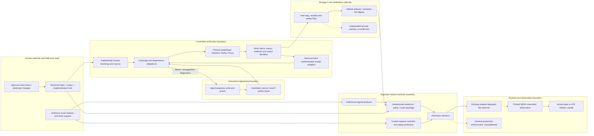
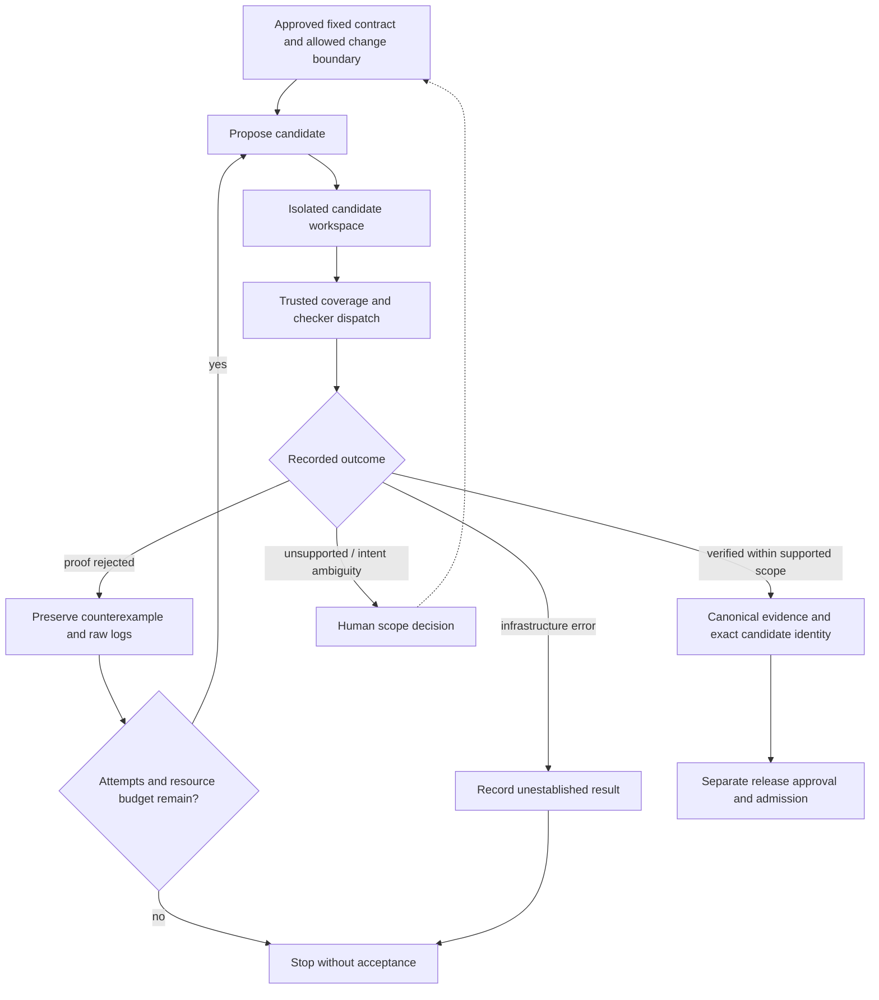

> Local audit snapshot for review. Many `results/` and tool paths below refer to
> the owner records workspace at `/Users/mackianni/forge`, outside this Git
> checkout. Those records are not all included here. This document is not a
> self-contained proof replay or authority to accept a claim.

# Forge — current state and proposed path

Status: 2026-11-03. CURRENT research stage: none. Stage11 is recorded complete.
Stage12 remains unauthorized. `end_to_end=false`.

This is an audit and design proposal under [FORGE_MASTER_MISSION.md](FORGE_MASTER_MISSION.md).
It does not approve a new specification, acceptance profile, workflow, merge,
signing operation, deployment, benchmark protocol, product stage or research stage.

## 1. Current-state audit

### Repository identity and document drift

- Live main: `f9eb1cbc252b28c80e5dfe2774da71bc35a31bd3`; tree `624ef75c46cdd260b39308763cfdf27ed8ba99e5`.
- Current implementation-lock SHA256: `76b983ac279a80ab42bf15c7446ee997a2bcd9b25a003db829f7e8fb2d4b8cd9`.
- Source audit: [/private/tmp/forge-campaign-main-20261102](/private/tmp/forge-campaign-main-20261102), detached main snapshot. No tracked changes; its untracked toolchain symlink is a local inspection convenience.
- The working records directory `/Users/mackianni/forge` is not a Git repository. Its documents and later evidence must not be confused with committed main.
- Main's ROADMAP header still says Stage9; its historical preamble says the six Stage9 EXITs are NOT RUN. Later local records contain actual Stage9 EXITs, Stage10/11 results and hosted integration evidence.
- Workspace and main README differ. Both contain historical claims that need reconciliation; neither should overwrite the other by assumption.
- VISION and AGENTS match the inspected main snapshot. VISION's old “current Stage7” wording is historical, not authorization to restart that stage.
- No local record silently replaces a historical entry or changes `unsure.md` in place.

Current PRs:

| PR | Exact head | Actual state | Scope |
| --- | --- | --- | --- |
| [34](https://github.com/mack-dot/forge/pull/34) | `46e5aa426bf7800df7c98c732a764337e716f6bb` | Draft, open, unmerged | Booking-only candidate used in the authorized hosted experiment |
| [36](https://github.com/mack-dot/forge/pull/36) | `705457e069abbe399128808b1efc7242d8eaeaa1` | Open, unmerged | Separate ordinary proof-report upload repair |
| [37](https://github.com/mack-dot/forge/pull/37) | `fc85ecc2c7f12caa6c8991fa002410bdf78dd51d` | Draft, open, unmerged; no reviews in latest read | Additional fixed-ELF model theorem and research evidence |

PR37's actual hosted gate returns3/UNSUPPORTED for14 uncovered proposal paths.
No verification evidence was accepted. Its report job succeeded; that does not
override refusal or demonstrate that PR36's separate repair was installed.
The filtered commit-run connector initially omitted this pull_request_target run.
The full PR check rollup and actual [verify log](https://github.com/mack-dot/forge/actions/runs/41672433464/job/126044039402) supply the result.

### Capability inventory

Definitions: ESTABLISHED means independently checkable support for the precise
stated claim; TESTED means bounded observations; PARTIAL means working parts with
missing required links; UNESTABLISHED means the required evidence/mechanism is absent.

| Capability | Class | Actual supported scope | Important gap |
| --- | --- | --- | --- |
| Ledger source C1–C5 | ESTABLISHED | Approved sequential Dafny contract over mathematical integers/maps | No automatic compiler, concurrency, persistence or service guarantee |
| Booking source B1–B4 | ESTABLISHED | Least free allowed slot, cancellation and idempotent accepted retries | Caller supplies valid state/authority; no durable/concurrent system |
| Refund source/boundary | ESTABLISHED for source; TESTED for integration | Approved exact acceptance/safety rules and recorded hostile controls | Runtime/TypeScript/compiler boundary remains scoped |
| Handwritten/generated JavaScript correspondence | TESTED | Existing finite model comparisons and property runs | Universal source-to-JavaScript semantic preservation UNESTABLISHED |
| Native Dafny/Boogie reuse | TESTED | Recorded fixed-corpus runs and rejection controls | Not a general Forge superiority result |
| Dependency-aware obligation selection | ESTABLISHED within declared inputs | Current registry, exact-source binding and fail-closed coverage | Not a generic sound dependency extractor for arbitrary languages/builds |
| Authenticated same-process receipt reuse | ESTABLISHED within trusted producer process | Complete receipt/output identity checks with in-memory anchors | No generic authenticated cross-process or cross-run adoption |
| GitHub-hosted booking workflow | TESTED | All13 acceptance cases matched on real Linux | A successful workflow is not executable-correctness proof |
| Exact historical RISC-V ELF model theorem | ESTABLISHED conditionally | ELF `8ced2ab6…`, native valid-entry domain, recorded579-module checking | Recorded QEMU SP does not satisfy its historical entry predicate |
| Additional memory-independent ELF model theorem | ESTABLISHED mathematically under stated assumptions | Recorded569-module check and exact source/object identities | New claim/profile remains unapproved; physical correspondence PARTIAL |
| Recorded QEMU/LPS projected conformance | ESTABLISHED finite model equality; TESTED actual run | 21 PC/GPR/FPR frames,13 observed words, guest exit0 | Full state, loader, accounting and syscall/runtime relation PARTIAL |
| Historical signed provenance and replay controls | ESTABLISHED in recorded trust scope | Exact old source/lock/claim/package, real Cosign/TUF and controls | Cannot transfer signature/approval to new claim or current runtime |
| Deployment observer | ESTABLISHED for narrow file identity; TESTED execution observations separately | Running isolated container's exact packaged-file read-back | File presence did not prove RISC-V execution in the admitted package |
| Production runtime admission | UNESTABLISHED | Research release/admission machinery exists | No general production deployment or complete runtime guarantee |
| Installable stable product CLI/API | PARTIAL | Script entry points, schemas and diagnostics exist | No stable packaged Python CLI; npm package remains private0.0.0 |
| Autonomous contract-to-implementation-to-proof product loop | UNESTABLISHED as an integrated product | Individual agent-assisted changes/proofs and bounded controls exist | No frozen end-to-end autonomous evaluation protocol/results |
| Autonomous reusable-lemma discovery | UNESTABLISHED | Human-selected ledger lemmas reused by booking | No held-out discovery benchmark against equal-budget baselines |
| Generalized external integrations/adapters | UNESTABLISHED | Multiple internal examples | Two distinct independently evaluated external integrations not established |

This table separates different claims inside a component. It never promotes a
test, signature, identity comparison or model theorem to whole-application proof.

### Actual execution evidence

The [hosted booking run](https://github.com/mack-dot/forge/actions/runs/41523691535)
used trusted main `f9eb1cbc…` and candidate PR34 `46e5aa42…`.

| Recorded hosted case | Gate exit | Booking verifier launches | Wall seconds |
| --- | ---: | ---: | ---: |
| Cold |0|1|28.525340852|
| Warm same-process reuse |0|0|9.931031468|
| Relevant helper-source invalidation |0|1|28.552900072|
| Restored valid reuse |0|0|9.784144014|
| Eight receipt/artifact/identity/harness/anchor/process attacks |1 each, expected|0|Per-case raw records retained|
| Uncovered change |3, expected|0|9.125844191|

The job consumed198 elapsed seconds/3.3 summed runner-minutes. Its usage endpoint
reported zero billable milliseconds. This is not an invoice, zero computation,
per-case bill or general savings estimate. Warm still runs outer-ledger work.
C changes a relevant helper in Booking.dfy; it does not establish every possible
cross-file/model/policy invalidation.

Artifact13179905102 ZIP SHA256:
`372cd7781b1be493a13bbd4398cb6871cbf2effe6458810425dd25fcf49efbf1`.
Fresh download matched the live API digest and original bytes. The record audit
returned0. Cold/invalidation each retain238 Passed TRX results and raw Dafny logs
with238 verified/0errors. Outer-ledger raw snapshot/audit logs were not uploaded;
their parsed member counts remain producer-reported.

Current new local checks:

| Command/check | Actual exit | Interpretation |
| --- | ---: | --- |
| Existing initializer plus unchanged theorem instantiation |0|Formal legal-model witness; not actual QEMU correspondence|
| False nonempty-lazy / already-halted premises |1/1|Intended equality refusals|
| Pinned GNU readelf2.42 header/program-header inspection |0|Held ELF metadata and identity|
| Original archive/manifest/member check |0|10160 members per archive, zero mismatches|
| Existing strict integration EXIT |1|Off-machine backup unconfirmed|
| Aggregate accounted-step auxiliary compilation |137; OOMKilled=true|Failed experiment at unchanged4GiB, preserved|
| All21 separate access checks and corrected accounting composition |0|LPS model-prefix effects only; no physical-state correspondence|
| Pending-syscall boundary / false post-ecall premise |0 / 1|Correct dispatch guard and intended equality refusal|
| Published auxiliary-root assumption audit |0|Same13 inherited primitive names|
| New independent recursive auxiliary replay |0|594 modules,86 permitted closure assumptions; new process on this machine|
| Existing-process21-step prefix composition and fresh source rebuild |0/0|Rebuilt object39edf12f... matches byte for byte;halted-Model substitution rejects1|
| Full process-prefix independent recursive replay |0|595 modules,86 permitted closure assumptions;no OOM;new process on this machine|
| New pinned GDB/QEMU observation |0/0|Entry FCSR0 and all404 file-backed LOAD bytes observed;not physical refinement|
| Observer exact-marker / corrupted-capture controls |0 /1|9 local marker cases pass;modified text read-back rejected|
| Current100-file implementation-lock identity audit |0|Locked input bytes match; not a new proof run|

The aggregate normalization failure remains137/OOM. All21 instruction access facts subsequently compiled separately, and the proof composition compiled0 after a preserved tactic-focus failure1. A proposed extra-step access negative unexpectedly compiled0: its assertion was true for the raw CPU iterator, which can repeat an ecall without dispatch. That was an invalid negative oracle, not a security rejection. Its source/result remain intact. A separate false pending-state assertion correctly rejected1. The actual process relation requires no pending syscall before instruction transitions; new auxiliary checks establish that model boundary for indices0..20 and pending94 afterward. No theorem premise was removed.

The follow-up independent recursive replay passed0 over594 modules and the
same86 permitted closure assumptions. It used a new process on this machine,
with the unchanged published checker and4GiB limit. Kernel-operation wall time
was1415.391444559seconds. No new QEMU run occurred. Existing579/569/567 kernel
executions retain their exact historical scope.

The process-prefix follow-up passed independent recursive checking0 over595
modules and the same86 closure assumptions. Kernel operation1658.714140672s;
outer container1659.407074542s. It composes the existing process rules through21
instructions,without changing the termination theorem. A fresh source build
reproduced the object. The exact Model/concrete-state relation remains open.

A separate local proposed observer uses pinned Ubuntu GDB15.1 and the held
QEMU/ELF. It observes FCSR0 and both complete LOAD ranges344+60bytes in a new
run. A changed read-back rejects1. Its458-line pre-exit trace prefix matches the
historical literals;whole raw logs differ by final process ID. The guest auxv
identifies the extra RX page as the new run's vDSO,with unresolved GDB string-
table/readelf dynamic-section diagnostics. No full vDSO validity is inferred
from a zero tool exit. Reservation and the sparse Model ledger remain unobserved.
New observations do not establish old hidden state or universal runtime fidelity.
The initial local marker-prefix bug and its exact-field repair/control records
are preserved. No authoritative observer/profile is adopted.

A complete observer-content replay then rejected22 bytecode caches generated
by the first writable version probe. Current observer attempt0003 uses a fresh
read-only package tree with bytecode writes disabled. The unchanged matcher
verifies two repository signatures,four package-index digests,13 archives and
all413 file/symlink members. Before/after identity0/0 and a fresh observation0
confirm the repair. The earlier failed tree is preserved. Publisher content
authentication is not debugger correctness or authoritative claim approval.

Evidence directories:

- [Hosted audit](results/hosted-booking-exit-review-2026-11-03/attempt-0001/STATUS.md).
- [84-row assumption matrix](results/fixed-elf-assumption-matrix-2026-11-03/attempt-0001/MATRIX.md), with JSON/CSV,13 direct and86 recursive named assumptions.
- [Current assumption/replay follow-up](results/fixed-elf-assumption-matrix-2026-11-03/attempt-0002/STATUS.md), which supersedes the earlier NOT RUN auxiliary-kernel checkpoint only.
- [New auxiliary recursive replay](results/runtime-auxiliary-kernel-2026-11-03/attempt-0001/postflight.json).
- [Current process-prefix and observer results](results/fixed-elf-assumption-matrix-2026-11-03/attempt-0003/STATUS.md).
- [595-module independent replay](results/runtime-process-prefix-kernel-2026-11-03/attempt-0001/postflight.json).
- [QEMU source assumption inspection](results/qemu-source-assumption-audit-2026-11-03/STATUS.md).
- [Separate observer review proposal](proposals/fixed-elf-observer/README.md).
- [Source/trust surface audit](results/master-mission-audit-2026-11-03/attempt-0001/source-and-trust-surface.json).
- [Historical consumer controls](results/campaign-consumer-controls-2026-11-02/).
- [Historical kernel replay](results/campaign-kernel-recheck-2026-11-02/attempt-0001/).
- [Original memory-independent proof checking](results/campaign-memory-feasibility-2026-11-02/attempt-0001/).
- [Observation kernel checking](results/campaign-observation-kernel-2026-11-02/attempt-0001/).
- [PR37 publication](results/elf-proposal-publication-2026-11-03/attempt-0001/).

### Backup and integration EXIT

Local archive integrity is established. The owner now reports that a backup
exists on another device. Record this as owner confirmation of a copy, not an
independently executed integrity or restore result. The specific archive pair,
device/location and coverage of newer records are not yet identified. The
expected remote read-back is absent. Earlier accessible Drive searches found no
matching archives; the owner's statement supersedes an inference of absence.

GitHub holds selected signed bundles, the booking artifact and PR37's packet.
Those are limited off-machine copies. They do not contain the original
raw/sanitized archive pair or all newer local evidence. The prepared November1
copy procedure covers only that pair; later required records need a separate
dated snapshot and restore validation. Preserve the original archives.

The unchanged integration status command currently returns1 with the sole false
predicate `off_machine_backup_confirmed`. `protections_verified=true` means
inspected, not that GitHub enforces passing checks. Fresh read-only administrator exports confirm rules require
review but contain no required status/workflow check. That remains an administrator
decision; no protection change was performed.

## 2. Capability gaps

| Priority | Missing link | Existing basis | Required evidence |
| --- | --- | --- | --- |
| P0 | Independent evidence preservation/restore | Local manifests and prepared private-host procedure | Remote full member/hash validation, independent storage identity and actual restore check |
| P0 | Consistent current documentation | Current raw records and exact GitHub identities | Minimal source-based corrections, preserved history, reviewable publication |
| P0 | Independent protected-change review | Exact PR36/37 heads and review rules | Genuine human/code-owner decisions; no agent self-approval |
| P1 | Actual-state-to-LPS correspondence | Exact ELF, finite conformance and unchanged theorem | Account for all8 machine fields, two model premises, loading, effects and runtime trust |
| P1 | Complete new-claim provenance binding | Existing Stage9 consumer/controller | Exact approved claim/profile/evidence/artifact/runtime binding and adversarial controls |
| P1 | Repository-wide enforcement claim | Gate refusal and review rules | Administrator-approved required-check policy; independent exports and real merge controls |
| P2 | Safe durable evidence reuse | Same-process repair and old signed artifacts | Authenticated producer/closure/policy/environment binding and cross-run adversarial replay |
| P2 | Autonomous engineering loop | Existing candidates, checkers and structured reports | Bounded isolated loop with fixed approved contract and independently adjudicated outcomes |
| P2 | Component executable semantics | Source proofs and finite JS comparisons | Supported compilation/translation-validation/direct executable method or explicit narrow trust contract |
| P3 | Product/installation | Existing script interfaces | Clean supported-host install, stable small CLI and honest diagnostics |
| P3 | Generalization and comparative benefit | Internal examples and preparation measurements | Two distinct external integrations and frozen held-out equal-budget comparisons |

Large runtime proofs, a generic cache, an agent orchestrator and product adapters
must not all begin at once. The dependency order above constrains implementation.

## 3. Proposed target architecture

Solid connections below describe the existing narrow mechanisms or their required
composition. Dashed connections mark missing or future capabilities. These diagrams
do not establish those connections by drawing them.

The agent has no path to modify S, issue its own release authority, fabricate
checker success or consume an unauthorized controller request. Candidate bytes
and stored evidence are data. A signature does not substitute for required proofs.
The dashed FI→EX link is deliberate: current file identity in an admitted
container does not establish that the separately tested QEMU execution was that
admitted deployment.

| Component | Existing implementation | Proposed completion |
| --- | --- | --- |
| A Intent/specification | Protected specs, locks and exact approval records | Ambiguity/counterexample workflow; human approval before behavior changes |
| B Autonomous engineering | Agent-assisted candidate/proof preparation | Isolated bounded repair loop and attempt accounting |
| C Independent verification | gate/core.py, backend adapters, pinned Dafny/Rocq | Preserve distinct evidence methods; add backends only for a demonstrated need |
| D Dependency-aware verification | gate/coverage.py, incremental.py, obligations.py | Explicit supported dependency closure, cost reporting and refusal outside scope |
| E Source-to-execution | Binary theorem, finite runtime projection, matrix | Smallest justified loader/state/syscall connection; no universal compiler/QEMU claim |
| F Proof-carrying release | gate/provenance/{producer,release,observe}.py | Approved new-claim binding and scoped runtime admission; production stays unestablished |
| G Knowledge/proof reuse | Shared ledger lemmas, native cache, process anchors | Checked lemma interfaces; authenticated durable reuse only after its own proof/trust contract |
| H Developer experience | Script CLI, JSON schemas, PR reports | Small installable CLI, independent replay command and clear unsupported diagnostics |

Use the existing JSON/manifest formats, GitHub artifacts, published checkers and
release controller. Do not introduce a new database, signing service, custom
verifier, ISA implementation or scheduler platform by default.

Proposed bounded engineering loop:

This loop is a design proposal. Existing autonomous operation has not yet been
benchmarked as an integrated Forge product. Every attempt, including failed proof
search and infrastructure setup, must count toward cost and maintenance burden.

## 4. Prioritized milestone roadmap

These are planning milestones, not Stage12 authorization.

| Milestone | Dependency / scope | Adversarial controls | Acceptance criterion / authority |
| --- | --- | --- | --- |
| M0 Truthful current-state packet | Existing code/records/live PRs; this document and matrix | Cross-check summary versus raw logs and hashes | Actual states/limits agree; audit-only work authorized |
| M1 Preserved reproducible foundation | M0; backup, doc reconciliation, PR36 independent review | Archive/member corruption, missing read-back, stale-head review | Remote restore verified; current docs; separate review/merge grants required |
| M2 Fixed-ELF runtime boundary | M0; unchanged theorem, all-field matrix and minimal auxiliary checks | Wrong loaded bytes, hidden-state mismatch, syscall/identity substitution | Narrow conditional assurance case with every residual assumption explicit; new intent/profile approval required |
| M3 New-claim evidence binding | M1/M2; existing provenance mechanisms | Wrong producer/claim/policy/environment, stale/replayed request | Independent authenticated replay/admission for exact approved scope; separate signing/admission authority |
| M4 Autonomous supported source loop | Stable M1, approved narrow task set | Unapproved spec edit, planted assumption, missing obligation, fake result, harness mutation | Bounded independent decisions over fixed contracts, full attempt/cost records; protected changes need exact approval |
| M5 Real component executable path | M2/M4 feasibility; one booking/ledger boundary | Compiler-output/runtime-interface substitution, representation boundaries | One useful exact executable property or explicitly limited compiler/runtime trust contract; new spec/implementation authority |
| M6 Product wedge and second integration | At least two demonstrated distinct integrations before abstraction | Clean install/replay failure, bad adapter, incomplete coverage | Small stable CLI/API and independently reproduced external use; not currently implemented |
| M7 Comparative evaluation | Frozen design and stable compared methods | Held-out tasks, negative controls, independent adjudication | Matched budgets and full raw data; no superiority claim before results |

No milestone automatically expands the accepted change set or starts another stage.

## 5. Next five actions

| Order | Action | Ready work | Human/external prerequisite |
| --- | --- | --- | --- |
| 1 | Preserve and restore the evidence independently | Local archive checker/procedure ready; hashes pass | Independent private host or verifiable existing copy; remote integrity/storage identity and restore evidence for original and later required records |
| 2 | Reconcile workspace/GitHub documentation through a minimal exact patch | Evidence and drift inventory ready; prepare corrections without replacing historical entries | Review/publication authority for the exact new documentation change |
| 3 | Finish PR36's independent review and separately authorized merge | Exact one-file patch and prior validation ready | Human reviewer; required approvals; explicit merge authority; real upload check afterward |
| 4 | Review the fixed-ELF entry/Model relation and residual runtime assumptions | Existing-process prefix0,byte-identical rebuild0,kernel595/86 exit0;new local FCSR0/404-byte LOAD observations;reservation/Model/refinement remain open | Independent exact-head and observer/claim/profile scope decisions remain separate;no policy activation |
| 5 | Freeze the matched evaluation protocol before performance/product expansion | Write workload/method/budget/metric definitions; retain all existing measurements | Independent task/spec adjudication and protocol approval; additional workflow/benchmark dispatch grants when needed |

These actions do not require Node integration, SPM work, another verification
framework or a new permanent service.

## 6. Benchmark design — proposed, NOT RUN

Do not call this preregistered until its exact protocol/task manifest is frozen
and approved. Do not claim superiority from current preparation samples.

### Workloads and baselines

Use held-out tasks with independently adjudicated intended behavior and a declared
supported/unsupported classification. Include legitimate edits, seeded defects,
dependency changes, vacuous/weakened specifications, forged evidence and coverage
escapes. Keep development tasks and hold-out tasks separate. Freeze repository,
source, spec, pins, model, seed/split and scoring before runs.

Compare:

1. Ordinary tests/CI.
2. Standard formal verification with human-guided proofs.
3. The same implementation model/agent without Forge's gate workflow.
4. Full fresh verification, native verifier caching and fixed reusable lemmas.
5. Forge's supported incremental method, with the same required claims and trust controls.
6. Agent-discovered lemmas only after that capability exists and is separately authorized.

Use the same model version, prompts/tool permissions where comparable, task
contracts, hardware/runner images, verifier options, output mode, claim coverage
and attempt/compute budgets. Record human time separately. Cold, same-input reuse
and dependency-invalidated cases form separate strata.

A native-cache solver-only command and a full Forge gate are not matched
end-to-end measurements. Either include equivalent policy, coverage, identity and
provenance work in every path, or report proof-work timings separately. Preserve
intrinsic process/startup differences and quantify them; do not hide them.
If equivalent methods cannot support the same scope, mark the comparison partial.

### Outcomes and cost

Primary correctness outcome: independent requirement satisfaction at acceptance.
Report false acceptance, false rejection, correct unsupported refusal and scope
coverage separately. An unsupported task must never become a passing proof.
Zero observed false accepts is a finite result, not universal soundness.

Collect actual:

- Claims established by method and complete required coverage.
- Attempts, rejected proofs, infrastructure failures and unsupported outcomes.
- Invalidated, executed and reused obligations/receipts.
- Real subprocess/solver/proof execution, including old versus current receipt fields.
- Wall time, setup/startup, evidence discovery/validation, reproduction and review time.
- Summed elapsed runner-minutes and independently sourced billed use; never infer an invoice from elapsed time.
- CPU, peak memory, API/model tokens and actual prices at execution time; no estimates presented as observed costs.
- Spec/proof authoring and maintenance effort, human interventions and generalization failures.

Use repeated paired/counterbalanced runs, preserve raw observations and report
uncertainty. Choose sample size/stopping rules in the frozen protocol. Include
proof discovery, maintenance and failed candidates in the total budget.
A faster but weaker acceptance path cannot establish a benefit.

Current constraints: Stage6's75 pairs concern its fixed corpus; Stage10's historical
51-case benchmark had47 matches and4 unsupported false accepts; current coverage
controls do not retroactively revise that record. The later native-cache
preparation samples had unequal process/envelope work. None establishes this
new held-out autonomous-system comparison.

## 7. Risk and complexity assessment

### Trusted surface measurements

Current lock/input audit0 measured100 locked repository files,896182 bytes and
16403 text lines, plus45 pinned container Python dependency file entries.
This is a locked input surface, not a total TCB count: it includes evidence and
subject artifacts and excludes whole external checker/model/runtime/OS/hardware stacks.

Current source surfaces (not all independently trusted code):

| Directory | Files | Text lines | Bytes |
| --- | ---: | ---: | ---: |
| gate/ |33|5591|369977|
| policy/ |4|379|11339|
| spec/ |8|1516|71193|
| schemas/ |2|442|9881|
| .github/workflows/ |12|955|46086|

Historical model proof closures checked579,569 and567 modules for different
statements. The new theorem wrapper names13 direct primitive assumptions; its
recursive closure names86. Those are different units and are not a total
line-count or a claim of zero trusted axioms.

### Principal risks

| Risk | Evidence/impact | Control or next check |
| --- | --- | --- |
| Wrong or incomplete human intent | Spec-quality survivors; model truth does not establish intent | Exact contract approval, examples, witnesses and counterexamples |
| Unmodeled runtime boundary | Projected equality lacks full state/loader/syscall correspondence |84-row matrix, minimal existing-LPS obligations, explicit assumptions |
| Forged/stale receipt adoption | Original corruption attack was real | Current process anchors, complete output integrity, prior-process rejection |
| Candidate authority injection | Gate/bootstrap/policy/harness can be targets | Trusted exact source, held expected roots, candidate-as-data and least permissions |
| Storage loss or unreproducible setup | Original backup unconfirmed; newer local work not in old archives | Independent full validation/restore and preserved dependency identities |
| Repository enforcement gap | Required review exists; required passing checks absent in recorded export | Administrator decision; no bypass or silent protection change |
| Provenance overclaim | Old signature cannot authenticate new statement | Exact claim/source/policy/runtime/request binding and replay controls |
| Agent self-certification | Candidate and its tests could share an error | Established independent checkers and separate review/release authority |
| Valid proof of the wrong statement | True/weaker propositions can compile successfully | Exact typed claim binding,held expected identities and negative substitution controls |
| Excess complexity |12 workflows and multiple historical probes; repeated metadata/status mechanisms | Inventory active versus historical mechanisms; isolate before deletion |
| Cost/latency | Independent kernels take many minutes; aggregate accounting OOM137 | Small compositional checks, unchanged limits, honest full-cost measurement |
| Premature generalization | Internal examples do not prove cross-repository utility | Two distinct demonstrated integrations before adapter/registry abstraction |

### Simplification opportunities

- Keep one authoritative current-state index while retaining raw historical records.
- Keep record-inventory code separate from verification/admission authority.
- Reuse the current gate, checkers, manifests, artifact storage and release controller.
- Catalog old probe/dry-run workflows; do not delete or rewrite them without dependency/approval review.
- Retain one precise same-process reuse contract until durable authentication is demonstrated.
- Make diagnostics distinguish proof rejection, unsupported input, infrastructure failure and missing approval.
- Prefer one supported component boundary to a premature plugin platform.
- Preserve the difference between installable UX, improved latency and stronger correctness.

This step adds documentation, evidence inventory and local auxiliary proof
obligations. It adds no runtime infrastructure or trusted gate code. Operational complexity increased slightly through audit
artifacts; no new service, database, framework or accepted proof mechanism was added.
The observer supplement adds pinned GDB observation-tool trust and13 unpacked
package artifacts for local experiments. It does not change the100-file
accepted implementation lock. A28-source review archive exposes the new proof
dependencies;it is not standalone or authenticated provenance. This is added
research/observation complexity,not a smaller accepted TCB or a product feature.

## Immediate next action and unresolved authority

The composed process prefix passed independent recursive checking in a new process:595 modules and86 permitted closure assumptions. The next boundary is review of the exact snapshot-to-existing-model/process relation and residual reservation/runtime assumptions,keeping the original theorem and both Model premises unchanged. Current debugger observations establish FCSR0 and404-byte LOAD identity for a new run;full physical correspondence remains open. See results/fixed-elf-assumption-matrix-2026-11-03/attempt-0003/STATUS.md and proposals/fixed-elf-observer/CLAIM_BOUNDARY.md. Review the concrete unpublished supplement before any publication or authoritative profile proposal.

The existing backup needs its device/location and archive identity recorded,
followed by integrity/restore validation. PR36/PR37
need their independent reviews and exact later authorizations. No additional
policy, protection, signing, admission, deployment, Stage12 or substantial new
product implementation is authorized by this document.

Full mission outcome remains UNESTABLISHED. The first seven requested planning
deliverables are present here; their proposed implementations and benchmarks
are not represented as completed work.
