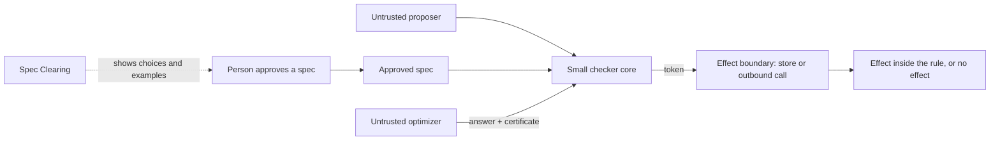

# Forge

**LLMs propose, checkers dispose. Humans approve intent (specs), not code.**

North star (the owner's words, 2026-11-19): **Zero implementation
review. Independently verified guarantees.** That is the aim. It is not
the present state: see the status line below and the evidence table.

Forge is a public research prototype for **proof-gated software
changes**. Untrusted code (an agent, an optimizer, a person in a hurry)
proposes. An established checker decides. Each accepted artifact
carries evidence that is tied to its exact bytes, its specification,
the checking method and the assumptions.

Status on 2026-11-19: no stage is CURRENT (Stage 9 is deferred). M1 is
open. Stage 12 is unauthorized. **`end_to_end=false`**: no result here
is a proof of a deployed system. The execution record is
[ROADMAP.md](ROADMAP.md). The uncertainty log is [unsure.md](unsure.md).

## The idea in three parts



1. **Spec Clearing.** Before a person approves a spec, a tool shows
   whether the spec leaves a choice to an implementation (`NO_CHOICE`
   or `CHOICE` with two verified implementations that differ), whether
   it accepts anything at all, and concrete before/after examples for a
   spec change (`EQUIVALENT` or `DIVERGES`).
2. **Proof-Carrying Finality.** A small checker core compares a
   proposed state transition with the approved relation and issues a
   token. The effect boundary takes an effect only with a valid token,
   a matching pre-state hash and a fresh request id.
3. **Runtime Certificates.** An untrusted optimizer returns an answer
   with a certificate. A small check accepts the answer only if the
   certificate shows that it is within a stated factor of the optimum.
   The optimizer can be replaced without a new proof.

The working record of this idea, with every item and its actual state,
is [FORGE_MASTER_IDEA.md](FORGE_MASTER_IDEA.md).

## Scope: blast radius, not intent

Forge limits the **blast radius** of wrong upstream code. At a boundary
that Forge owns, the worst effect of a wrong proposal is an effect that
the structured rule allows.

Forge does **not** show that a proposal is what a person meant.
Example: a customer asks for $10 in free text. An agent reads the text
and proposes $80. The rule is a cap of $100. The checker issues the
token, and that is correct for the rule. A smaller blast radius needs a
tighter structured rule. It does not come from a claim about the prose.

Also outside the claim: the user interface and liveness upstream of the
boundary, and server code of a third party (for example a payment
processor). A wrong spec stays wrong after a proof: the premise stays
with the person who approves it. Spec Clearing is aimed at that step.
It makes the approval easier to do well; it does not move the
responsibility. Full text:
[scope section](FORGE_MASTER_IDEA.md#blast-radius-finality-vs-intent-elicitation-scope-and-honest-limits).

## Evidence classes

A result has exactly one class. A test count is never a proof.

| Class | Meaning |
| --- | --- |
| `source_proof` | A proof checker (Dafny) accepted a claim for source text, for all inputs, under stated assumptions |
| `in_logic_compiler_proof` | A compiler correctness theorem inside a proof assistant covers the step from source to machine code, under its premises |
| `binary_proof` | A claim about the exact bytes of a compiled program, checked by a proof assistant, under a machine model |
| `runtime_certificate_checked` | A proved check accepted one certificate for one answer at run time |
| `tested_against_proved_model` | Finite runs compared an unproved program with a proved model |
| `unit_tested` | Finite runs with recorded rows |
| `floor_controls` | Planted faults that a check must reject, to show that the check can fail |

## Evidence and trusted base

"Not proved" names the largest unproved part, not every one. Each row
links its record. Numbers are from the records of the named runs on one
machine and one hosted runner profile.

| Work | What holds, and its class | Not proved; trusted | Record |
| --- | --- | --- | --- |
| Stage 1: ledger | Claims C1 to C5 of the approved ledger spec for `impl/Ledger.dfy`: `source_proof`. Four planted bugs pass a weak unit suite and fail the gate: `floor_controls` | Dafny, Boogie, Z3; sequential calls over mathematical integers | [evidence](evidence.json), [claims](docs/claims.md) |
| Stage 2: evidence format and policy | Bundles bind claim, spec digest, artifact digest, method and tool; the gate rejects a changed identity and a weaker method: `floor_controls` | the gate code itself | [gate](gate/README.md) |
| Stage 3: TypeScript | Handwritten TypeScript against the compiled model, 300 property runs and 4,131 state comparisons: `tested_against_proved_model` | the TypeScript, Node, the Dafny JavaScript back end | [TypeScript notes](ts/README.md) |
| Stage 4: change loop on GitHub | A real pull request loop: an implementation edit checks 2 member obligations and reuses 10; an unapproved spec change is rejected: `floor_controls` and recorded runs | GitHub, the runner, the approval record | [change loop](docs/stage4-change-loop.md) |
| Stage 5: spec quality | A success witness; a reject-all spec is flagged; mutants. The `print` survivor is closed since pull request 43 (item F1.2: print effects are tracked); one labelled algebraic rewrite survives | finite diagnostics; they do not show that a spec is the intent | [spec quality](docs/spec-quality.md) |
| Stage 6: booking and reuse | Booking claims B1 to B4: `source_proof`. A benchmark of 75 baseline and candidate pairs measures verifier time with reuse | times are for this corpus and host | [booking](docs/booking.md), [benchmark](docs/reuse-benchmark.md) |
| Stage 7: C to RISC-V | Every valid execution of one exact 1,240-byte RISC-V ELF (a C self-test) terminates with status 0 under the pinned machine model: `binary_proof`. The proof is about the bytes of the ELF; it does not use a compiler proof. An upstream statement was replayed first, and a control with a valid but unrelated certificate was rejected; 579 modules checked independently; 86 permitted closure assumptions | the Rocq kernel, the machine model, the checker image, the processor. A termination claim, not a functional claim about a product program | [binary record](docs/stage7-binary.md) |
| Stage 8: refund boundary | Claims R1 to R5 of the approved refund spec for `impl/Refund.dfy`: `source_proof`. Wrapper with 9,000 generated cases and 68 fixtures: `unit_tested` | the wrapper, the JSON parser, the executor | [refund record](docs/stage8-refund.md) |
| Stage 9: provenance | Contract and tools are in the tree. Its six EXIT cases are NOT RUN on `main`'s present bytes: 8 lock entries are stale and the renewal needs a hosted signing run that is not authorized | — | [ROADMAP.md](ROADMAP.md) |
| Stage 11: incremental verification | An obligation graph decides what a change must check again; a stale dependency is rejected; three EXIT cases exit 0 on recorded evaluations: `floor_controls` and recorded runs | the input declarations of each gate | [ROADMAP.md](ROADMAP.md) |
| Round 4: the gate guards itself | Eight modules of the pull request gate are frozen; a change to a protected path needs a ratification record on the trusted side; control sets with 0 evasions: `floor_controls`; three independent reviews | four more gate modules stay ratifiable (stated limit) | [checklist](proposals/forge2-pillar1-print-effects/v3/BOOTSTRAP_CHECKLIST.md) |
| Slice 1: refund finality | Checker core `impl/RefundFinality.dfy`, claims P1 to P4 (a token only for an authorized transition; every authorized transition gets one; no intent on refusal; token binding): `source_proof`. Issuer, sink and dispatcher: 115 suite rows, 48 rejection attempts with 0 effects: `unit_tested`. 10 of 10 copies with one check removed fail | the compiled JavaScript, the issuer, Ed25519 in Node, SQLite, process isolation. The claim text is not approved intent | [Slice 1 report](proposals/forge2-slice1-refund-finality/REPORT.md) |
| Slice 2: spec clearing | `NO_CHOICE` for the three approved specs; `CHOICE` for two planted loose specs; `EQUIVALENT` and `DIVERGES` with examples: each verdict rests on Dafny lemmas (`source_proof` of the lemma; the tool is dispatch only). 11 of 11 copies with one check removed fail | the tool; a person must read the hand-written claim lemmas | [Slice 2 report](proposals/forge2-slice2-spec-clearing/REPORT.md) |
| Slice 3: runtime certificates | Certificate checker core against a candidate spec (not approved): `source_proof`. Three optimizers (TypeScript, safe Rust, an adversarial Python program) exchanged against one compiled core with 0 Dafny starts for the exchange; 84 allocations committed, each for a token: `runtime_certificate_checked` by an unproved compiled core; 0 tokens for the adversary. 26 of 26 copies fail | the compiled core, issuer, sink, the macOS sandbox tool (trusted, one platform). Sound, not complete | [Slice 3 report](proposals/forge2-slice3-runtime-certificates/REPORT.md) |
| M1: CakeML to ARM64 (OPEN) | For one refund program, HOL4 theorems show that a machine MODEL that holds the exact ARM64 code bytes, under explicit premises, either halts with output equal to the rendered decision or stops at a resource limit with a prefix of it, possibly empty (verified machine-model behaviour; wording corrected 2026-11-19); 95 theories replay with equal exports on rebuilt tools. Nothing formal links the real process to that model: that link is an informal assumption, and two premises of the theorem are false for real machines as written: the FFI contract (probably) and the processor bits TBI0 and SA0. Verified native execution is NOT established. This is an `in_logic_compiler_proof` chain that is NOT closed: no M1 theorem is claimed | open premises (entry state, loader, foreign code, processor), the HOL half of the link to the approved contract, clean and independent replays; the replay of the 158 recorded cases is not complete (3 cases have no source) | [replay report](proposals/refund-executable-feasibility/m1-chain-replay-20261118/REPORT.md) |
| Wave Gate 1: M1 conformance | The M1 executable and the compiled Slice 1 checker give the same decision, amount, reason and ids on 2,466 typed vectors; 24,039 tampered transitions refused; 0 findings: `tested_against_proved_model`. 57 planted faults and 25 wrong cores found: `floor_controls`. 23 of 23 copies fail | everything: it is a finite test, not a compiler proof and not an M1 result | [conformance report](proposals/forge2-m1-conformance/REPORT.md) |

### Facts worth knowing

- **An audit trap in Dafny, found and closed.** Inside an `abstract
  module`, the pinned Dafny accepts a lemma with no body, and
  `dafny audit` reports only on the files of its command line. The
  first clearing tool gave a false `NO_CHOICE` that way. The tool now
  writes a non-abstract instance, and the earlier results that could
  have had the same hole are marked (Slice 2 report, `unsure.md` U450).
- **Checks are tested by removing them.** In Slices 1 to 3 and Wave
  Gate 1, 70 copies of the check scripts with one check removed each
  (10, 11, 26, 23) all fail.
- **Reviews find what the author misses.** Each slice had one review by
  an agent with a fresh context. They found, among others, a fail-open
  sink, an optimizer that could write the sink's database, and a
  conformance check that passed with an empty fixture file. The
  findings and repairs are in each `REVIEW.md`.
- **Two machine-code roots, both narrow.** C to RISC-V (Stage 7): a
  termination proof for the bytes of one small self-test. CakeML to
  ARM64 (M1): a refund program whose chain through the proved CakeML
  compiler is not closed.
- **What `end_to_end=false` covers.** No proof here covers a compiled
  JavaScript program, an issuer or a sink process, a key, a database,
  an operating system, or a deployment.

## Run it

First follow the [toolchain setup](toolchain/README.md) and the
[TypeScript setup](ts/README.md). The pins describe specific tested
environments; other tool versions do not satisfy the gate.

```sh
python3 gate/gate.py --impl impl/Ledger.dfy --evidence evidence.json
python3 scripts/build_model.py
node --import tsx app/main.ts
```

The demo prints `Ok`, then `Rejected`.

Each later piece of work has one EXIT script with named cases, for
example:

```sh
python3 scripts/exit_slice1.py --case evidence          # refund finality
python3 scripts/exit_slice2.py --case evidence          # spec clearing
python3 scripts/exit_slice3.py --case evidence          # runtime certificates
python3 scripts/exit_m1_conformance.py --case evidence  # M1 conformance (macOS arm64 only)
```

One command runs a live demonstration on the real components of the
three slices (attacks on the issuer and the sink, a flood of bytes, an
exchange of optimizers in three languages). It is a finite
demonstration, not a proof: [the skeptic gauntlet](docs/demo-gauntlet.md).

```sh
python3 scripts/demo_gauntlet.py
```

A scenario can exit `0` because it observed the required rejection.
Reports keep checker, gate and scenario exit codes apart. The hosted
pull request gate answers `UNSUPPORTED` (exit 3) for a change whose
files no obligation lists; that is the expected answer for the slices
above, and it is not a `VERIFIED` result.

## Not done

- Productivity benefit, maintenance cost and use on ordinary
  repositories are not measured.
- Stage 9 (provenance with a hosted signing run) is deferred.
- The next-horizon items of the master idea are NOT STARTED: boundary
  tables and property red-teaming for specs, fact-bound sub-caps with a
  third verdict, a reservation protocol across processors,
  infeasibility certificates, a checker with parser and signature under
  one machine-code theorem.

## Documents

| Document | Purpose |
| --- | --- |
| [ROADMAP.md](ROADMAP.md) | Hard rules, stages, and every EXIT command with its actual exit code |
| [FORGE_MASTER_IDEA.md](FORGE_MASTER_IDEA.md) | The three-part idea, its scope, work items and their state |
| [unsure.md](unsure.md) | Append-only findings, uncertainty, corrections and resolutions |
| [VISION.md](VISION.md) | Long-term directions and irreducible limits |
| [docs/claims.md](docs/claims.md) | Generated explanations of the ledger claims |
| [gate/README.md](gate/README.md) | Gate commands and rejection controls |
| [AGENTS.md](AGENTS.md) | Instructions for agents that work in this repository |

To contribute: propose a spec change with an exact diff and a
plain-English reason, then wait for the owner's approval of the intent.
Do not weaken a spec, a policy or a gate to pass a check. Record real
commands and exit codes. Planned work is not a passing result.

## License

A license has not yet been selected. Public visibility alone does not
grant an open-source license.
