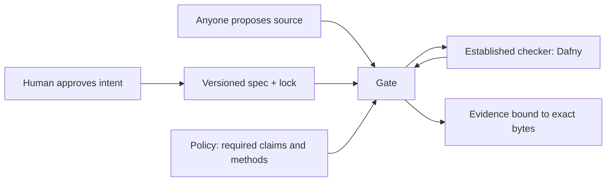

# Forge

**LLMs propose, checkers dispose. Humans approve intent (specs), not code.**

Forge is an open research prototype for **proof-gated software changes**.
Anyone, including an AI agent, can propose an implementation. An established
checker (Dafny, Rocq, Cosign …) decides whether the required claims hold.
Every accepted artifact carries reproducible evidence that names the exact
bytes, the specification, the checking method and the assumptions.

The goal: let agents change small, critical parts of real software, such as
money movement, refunds, bookings or permissions, while people stay
responsible only for *what* those parts must do.

## Try it in five minutes

Tested on macOS (Apple Silicon) with Python 3.10.11. The gate refuses other
Python versions. Every command below ran in a fresh clone with the exit code
shown.

```sh
git clone https://github.com/mack-dot/forge.git && cd forge

# 1. Pinned checker: Dafny 4.11.0 with bundled Z3 4.12.1
mkdir -p .toolchain/downloads
curl -fsSL -o .toolchain/downloads/dafny-4.11.0-arm64-macos-13.zip \
  https://github.com/dafny-lang/dafny/releases/download/v4.11.0/dafny-4.11.0-arm64-macos-13.zip
echo "c90c75e7d5db9c6ccbb7127840dfe43f0ac938b039a7ebed146d8ead383a572f  .toolchain/downloads/dafny-4.11.0-arm64-macos-13.zip" \
  | shasum -a 256 -c                                   # exit 0: OK
unzip -q .toolchain/downloads/dafny-4.11.0-arm64-macos-13.zip -d .toolchain/dafny-4.11.0

# 2. Pinned Python packages for the gate
python3.10 -m venv .toolchain/venv
.toolchain/venv/bin/python -m pip install -r toolchain/requirements-stage2.txt

# 3. A correct ledger is accepted
.toolchain/venv/bin/python gate/gate.py --impl impl/Ledger.dfy --evidence build/quickstart/ledger.json
# exit 0: ACCEPTED: C1 C2 C3 C4 C5; backend=dafny; tier=critical; end_to_end=false

# 4. A ledger with an off-by-one bug is rejected
.toolchain/venv/bin/python gate/gate.py --impl bugs/off_by_one.dfy --evidence build/quickstart/off-by-one.json
# exit 1: VERIFICATION_REJECTED: C4 not established; Dafny exit 4
```

The rejection reason is the **last** line of the output; the lines above it
are raw Dafny diagnostics. Try the other planted bugs in `bugs/`:
`retry_double.dfy` (C1, C3), `self_transfer.dfy` (C1, C5) and
`sneaky_assume.dfy` (rejected by the audit for an `assume`). Each of them
passes a deliberately weak unit-test suite and fails the gate.

Exit codes: `0` accepted, `1` rejected, `2` configuration or tool error.
`--evidence` must be `evidence.json` or a path under `build/`. Linux uses the
CI profile in [toolchain/linux-pins.json](toolchain/linux-pins.json)
(installed by `toolchain/install_ci.py`); it is exercised in CI, but this
quickstart was not run on Linux by hand.

## What just happened



The spec [spec/LedgerSpec.dfy](spec/LedgerSpec.dfy) states five claims (C1–C5,
below). The gate hashes the spec, the policy and your source, runs Dafny with
pinned resource limits, audits for forbidden constructs (`assume`,
`{:axiom}`, …) and writes an evidence bundle only if every required claim is
established by an accepted method. In our test, `build/quickstart/ledger.json`
was byte-identical to the committed [evidence.json](evidence.json).

| Claim | The ledger must … |
| --- | --- |
| C1 | preserve total funds on a transfer. |
| C2 | keep every balance non-negative. |
| C3 | return `Ok` for an identical accepted retry without repeating its effect. |
| C4 | on a fresh valid request, debit amount + 1, credit the recipient by the amount and credit fee account `0` by 1. |
| C5 | return `Rejected` for every other request and leave the state unchanged. |

## What is established today

Each row links to its exact commands, real exit codes and preserved failures.
"Proof" here means a machine-checked proof against the stated spec and trusted
base, nothing more.

| Area | Established | Method | Record |
| --- | --- | --- | --- |
| Ledger (Dafny) | C1–C5 for sequential operations over mathematical integers | `source_proof` | [evidence.json](evidence.json), [claims](docs/claims.md) |
| Ledger (TypeScript) | 300 property runs, 4,131 state comparisons against the proved model | `tested_against_proved_model` (testing, not proof) | [fee evidence](results/stage4/fee-typescript-evidence.json) |
| Change loop | Real PRs: implementation edit accepted; unapproved spec weakening rejected | gate on GitHub PRs | [PR #4](https://github.com/mack-dot/forge/pull/4), [PR #5](https://github.com/mack-dot/forge/pull/5) |
| Booking | B1–B4 and a checked cancellation/retry trace | `source_proof` | [docs/booking.md](docs/booking.md) |
| Refund boundary | Safety, exact acceptance, rejection on fallback; integration tested separately | `source_proof` + finite testing | [docs/stage8-refund.md](docs/stage8-refund.md) |
| Compiled binary | Every valid execution of a 1,240-byte RISC-V ELF terminates with status 0 under the pinned LPS model; 579 modules independently checked | Rocq proof via Theorem's pipeline | [docs/stage7-binary.md](docs/stage7-binary.md) |
| Spec quality | Success witness checked; 8 of 10 mutants killed, 2 survived | mutation diagnostics | [docs/spec-quality.md](docs/spec-quality.md) |

## What is **not** established

- **End to end.** All evidence keeps `end_to_end=false`. The Dafny proof does
  not cover the compiler, generated JavaScript, handwritten TypeScript,
  persistence, concurrency or a deployed service.
- **Intent.** A proof shows the code meets the written spec. If the spec misses
  what people wanted, the proof does not help. Two mutants survive spec-quality
  checks today (for example, printed output is unconstrained).
- **Signed releases.** Stage 9 (signed provenance) is in progress; no release
  has been signed yet.
- **Usefulness.** Productivity, cost and fit for ordinary repositories are
  hypotheses. Stage 10 will measure them on real PRs.
- **Portability.** Pins describe specific tested hosts (macOS arm64 locally,
  Ubuntu x86_64 in CI). Other tool versions do not satisfy the gate.

## How the project works

| Path | What it holds |
| --- | --- |
| `spec/`, `spec.lock` | Approved specifications and their hashes. **Protected.** |
| `policy/` | Required claims and acceptable evidence methods. **Protected.** |
| `gate/` | Dispatches established checkers and binds results to bytes. Never implements a verifier. **Protected.** |
| `impl/`, `ts/`, `app/` | Implementations that are checked against the specs. |
| `bugs/` | Planted bugs the gate must reject. |
| `proposals/` | Exact diffs and reasons for changes to protected files. |
| `results/` | Raw logs, commands and real exit codes for every stage. |
| [ROADMAP.md](ROADMAP.md) | Stages 0–10, required EXIT checks and actual results. |
| [unsure.md](unsure.md) | Append-only record of uncertainty, failures and corrections. |

Protected files change only through a proposal with an exact diff and a
plain-English reason, approved by the owner on its exact bytes. Nobody
weakens a spec, policy or gate to make a check pass.

## Contribute

Start with [CONTRIBUTING.md](CONTRIBUTING.md) and the issues labelled
`good first issue`. No special access is needed: fork, change, open a pull
request. On pull requests to `main`, the proof gate runs the trusted code from
`main` and reads your changes only as data, with a read-only token; a separate
job posts the report. For outside contributors, a maintainer approves the run
first.

Security issues: see [SECURITY.md](SECURITY.md). Report privately.

## License

Apache License 2.0; see [LICENSE](LICENSE) and [NOTICE](NOTICE). Third-party
material is listed in [THIRD_PARTY_NOTICES.md](THIRD_PARTY_NOTICES.md).
