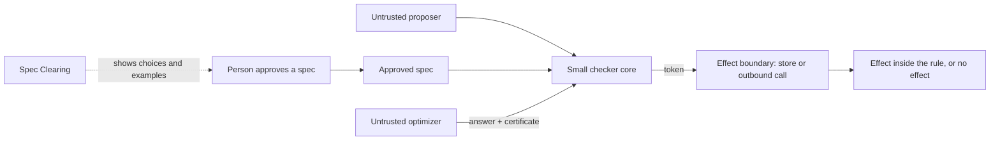

# Forge

**Forge is an airlock between AI agents and irreversible actions: a small Rust
engine checks each refund, payout step or booking against a written policy and
the current state, then commits it to a log or refuses it with a typed answer.**
It is a research prototype. It is tested on macOS on Apple silicon only, and the
engine is tested, not proved.

## Try it (no Dafny, no Node)

You need macOS on Apple silicon, `rustc` 1.92.0 on `PATH` and Python 3. From the
repository root:

```sh
bin/forge-airlock build
mkdir -p build/qs && bin/forge-airlock init build/qs/store --policy examples/unbreakable_store/policies/refunds.json
python3 - <<'EOF'
import sys; sys.path.insert(0, 'sdk/py'); import forge_airlock as fa
with fa.Store('build/qs/store') as st:
    print(st.open_money('acme', 'order-1', 'open-1', 'store-refunds', 10000, {'shipping_paid': 1000}).code)
    h = st.get('acme', 'order-1').state_hash                      # read the state hash first
    r = st.refund('acme', 'order-1', 'refund-1', h, 'SHIPPING', 8000); print(r.code, r.detail)  # $80, but $10 shipping paid
    print(st.refund('acme', 'order-1', 'refund-2', h, 'SHIPPING', 1000).code)  # $10: inside the policy
    print(st.refund('acme', 'order-1', 'refund-3', h, 'SHIPPING', 1000).code)  # the same old state hash again
    h = st.get('acme', 'order-1').state_hash
    print(st.refund('acme', 'order-1', 'refund-2', h, 'SHIPPING', 1000).code)  # the same request id again
EOF
```

Output of a run on 2026-11-20 (clean export of `236198b2`, one Apple silicon Mac;
each command exit 0):

```text
COMMITTED
REJECTED_POLICY REASON_CAP
COMMITTED
STALE_STATE_HASH
DUPLICATE_REQUEST_ID
```

The order opens with $100 and a $10 shipping fact. The $80 shipping refund breaks
the policy cap. The $10 refund commits. The next refund names a state hash that
is no longer current, so it is refused (compare-and-swap). The last one reuses a
request id that already has an effect, so it is refused. Only the two
`COMMITTED` lines wrote a record: `bin/forge-airlock replay build/qs/store` lists
them. More: [quickstart](docs/quickstart-5min.md) (TypeScript, leases, scoped
reads, cosign, payouts, bookings), [wire protocol](src/airlock/PROTOCOL.md).

> **What this is not**
>
> - **Not a proof of the engine.** The Rust engine is checked by test suites, a
>   fuzz pass, demos and one CI job. No proof covers it.
> - **Not a guard against a hostile agent yet.** The engine runs as your own OS
>   user. An agent that can write the store folder or the engine binary can go
>   around every check. No isolation mode ships. The tenant field is not
>   authenticated.
> - **One platform.** Tested on macOS on Apple silicon only. No run on Linux or
>   Windows is recorded.
> - **`end_to_end=false`.** Each proof here covers one small part. No proof
>   connects an approved rule to a real effect on a real machine.
> - **Approval is not enforced.** No approval channel exists that an agent
>   cannot forge, and `main` has no branch protection.

## How sure is each part?

Every result has one or more of four labels. A label covers only the part it
names: a proved part inside unproved code does not make that code proved.

| Label | What it means | What has this label today |
| --- | --- | --- |
| **PROVED CORE** | A proof tool (Dafny or HOL4) checked a statement for all inputs, about source code or about a model of a machine, under stated premises. It says nothing about the compiled program on a real machine | Dafny models: the ledger, the booking checker, the refund decision, the refund finality checker, the spec-clearing lemmas, the runtime-certificate checker, the Farkas lemma (non-negative integer `x` only) and some generated models. HOL4: theorems about a machine model that runs the CakeML-compiled refund program |
| **NATIVE CHECK** | Code that decides at run time and is not proved | **the Rust airlock engine** (`src/airlock`: every answer in the run above), the native refund sink, the MCP proxy, the primitives engine, the Python and TypeScript SDKs, the TypeScript issuer, sink and dispatcher |
| **FINITE TEST** | A finite set of inputs ran and the results are recorded. It shows nothing about inputs that did not run | test suites, fuzz passes, runs with one check removed on purpose (to show that the tests notice), demos, the macOS CI job |
| **TRUSTED ASSUMPTION** | Taken as correct; not checked here | Dafny, Z3, `rustc`, Node, the Dafny and CakeML compilers, the JSON-to-Dafny generators, `/usr/bin/ssh-keygen` (cosign), the macOS kernel and drive, the caller's OS user, the tenant field |

Example of the rule: for a refund whose policy has the profile
`canonical-refund`, a CakeML-compiled binary makes the decision. Its HOL4 theorem
is about a machine model, and the Rust engine checks the result again. The
decision has a PROVED CORE part; the engine stays a NATIVE CHECK.

## The proof work, in plain terms

- **Dafny (source proofs).** Small models are proved against their specs for all
  inputs. Example: the refund decision
  ([spec/refund/RefundSpec.dfy](spec/refund/RefundSpec.dfy), 64 lines;
  [impl/Refund.dfy](impl/Refund.dfy), 15 lines). These proofs are about the
  source text. The compiled JavaScript or binary is not proved.
- **HOL4 and CakeML (machine-code model).** The refund program is compiled to
  ARM64 with the verified CakeML compiler. HOL4 theorems show that a *model* of
  an ARM64 machine that holds those exact bytes either halts with the correct
  output or stops at a resource limit. The main theorem that would connect this
  to a real process (called M1) is **open**. Nothing formal links the model to a
  real Mac, and two premises are false for real machines as written. The 95
  theories replay with equal exports on rebuilt tools on the same machine. No
  replay by an independent party is recorded.
- **Rocq (one RISC-V binary).** A termination proof for the bytes of one
  1,240-byte RISC-V self-test. It is not a product program.
- **What would let an outsider check an actual run, and what is missing:**
  [the assurance-chain investigation](proposals/assurance-chain-20261120/README.md).

## Demos on `main`

Each demo is a FINITE TEST of unproved code. Run from the repository root after
`bin/forge-airlock build`.

| Demo | Command | Needs | Recorded run |
| --- | --- | --- | --- |
| A scripted hostile agent against the engine (film story) | `python3 demos/hal_9000/run_discovery_one.py --fast --no-color` | `rustc`; no Dafny, no model | [ROADMAP.md](ROADMAP.md) (U925) |
| MCP proxy in front of tool calls | `python3 examples/archia_mcp_showcase/run_showcase.py` | `rustc` | [release audit 2](proposals/release-audit-20261120/AUDIT2_DEMOS.md) |
| Rate limits, ledgers, taint and certificate checks | see [its README](examples/universal_self_repair/README.md) (one `rustc` line, then `run_demo.py`) | `rustc` | [release audit 2](proposals/release-audit-20261120/AUDIT2_DEMOS.md) |
| Eight store disasters through both SDKs | `bin/forge-airlock demo --json build/demo.json` | Node 24; the booking checker (`bin/forge-airlock build --checker`, Dafny 4.11.0 once) | [release audit 2](proposals/release-audit-20261120/AUDIT2_DEMOS.md) |
| Attacks on the proof-gate slices | `python3 scripts/demo_gauntlet.py` ([guide](docs/demo-gauntlet.md)) | pinned Dafny and Node | [release audit 2](proposals/release-audit-20261120/AUDIT2_DEMOS.md) |
| Web showcase (local only; nothing deployed) | see [web/README.md](web/README.md) | Node 24, npm, a Python virtual environment | [ROADMAP.md](ROADMAP.md) (U926) |

In progress, NOT on `main`: a checker that reads a refund log and checks it
against the stateful refund-log specification
([spec/refund/RefundLogSpec.dfy](spec/refund/RefundLogSpec.dfy), approved
2026-11-20). No program is checked against that specification on `main`.

## Where the records live

[ROADMAP.md](ROADMAP.md) holds every stage and work item with its real commands
and actual exit codes, kept apart from expected results and commands that did not
run. [unsure.md](unsure.md) is an append-only log of findings, doubts,
corrections and resolutions: no entry is ever changed or deleted, so a wrong
claim stays visible next to its correction.

A one-page map of what is merged and open: [docs/STATUS.md](docs/STATUS.md).

## License

Apache License 2.0: [LICENSE](LICENSE) and [NOTICE](NOTICE). The repository is
private at the time of this text. More in [License details](#license-details).

---

## Repository map

Five places matter for using the airlock:

| Path | What it is |
| --- | --- |
| [`src/airlock/`](src/airlock/PROTOCOL.md) | the engine (std-only Rust, no `unsafe`) and its wire protocol |
| [`sdk/`](sdk/py/forge_airlock.py) | the Python SDK and the [TypeScript SDK](sdk/ts/forge_airlock.ts) |
| `bin/forge-airlock` | the command line: `build`, `init`, `serve`, `replay`, `demo`, cosign tools |
| `examples/`, `demos/` | demos (table above) |
| [`docs/`](docs/quickstart-5min.md) | the quickstart, the status page, stage notes |

The proof work is in `spec/` (approved specs), `impl/` (Dafny models), `gate/`
(the proof gate) and `toolchain/` (pinned tools). Most other folders are the
research record: `results/` and `proposals/` hold run records and reports, and
many scripts and evidence records name those paths, so they stay where they are.
Internal planning notes are in [docs/roadmap/](docs/roadmap/README.md);
[FORGE_MASTER_IDEA.md](FORGE_MASTER_IDEA.md) and [VISION.md](VISION.md) stay
at the root because scripts and records name them there.

## For contributors and reviewers

The rest of this page uses the project's internal names. Short glossary:

| Name | Meaning |
| --- | --- |
| `end_to_end=false` | no result covers the whole path from an approved spec to an effect on a real machine |
| Stage 1 to 12 | the research stages of the proof gate in [ROADMAP.md](ROADMAP.md); "CURRENT" names the one in work (none today) |
| Slice 1, 2, 3 | the three parts of the master idea: refund finality, spec clearing, runtime certificates |
| Goal 19, Goal 20, Wave Gate 1, Gate F1, APEX-2, T19, V1.1 | named work packages; each has a ROADMAP section and a report |
| M1 | the open machine-code theorem for the CakeML refund program |
| M1-B | the open link from that machine model to a real process and a committed effect |
| S1, E2, E4, "blocker 5" | links and blockers of the [assurance graph](proposals/m1b-mission-20261119/TOP_LEVEL_GRAPH.md): S1 = an approval channel that an agent cannot forge (MISSING); E2 = the gate verdict as a required check for a merge (MISSING); E4 = separate trust domains for checker, agent and deployment (MISSING); blocker 5 = "Enforcement does not exist" |
| E1, E2 (Slice 1 row) | two red-team exploits of the old TypeScript sink (not the graph link E2) |
| U followed by a number | an entry of [unsure.md](unsure.md) |
| pull request N | a pull request of this repository; the merge commit is named where it matters |

### The aim

**The aim: LLMs propose, checkers dispose, and humans approve intent (specs),
not code.** This is an aim, not the present state. Today no approval channel
exists that an agent cannot forge (link S1 is MISSING), and nothing enforces
protected-path approval on `main` (`main` is not protected; links E2 and E4 are
MISSING; blocker 5 "Enforcement does not exist"). Sources:
[TOP_LEVEL_GRAPH.md](proposals/m1b-mission-20261119/TOP_LEVEL_GRAPH.md) (S1, E2,
E4, blocker 5) and
[the graph refresh](proposals/m1b-mission-20261119/TOP_LEVEL_GRAPH_REFRESH_20261119.md)
(E2, E4).

North star (the owner's words, 2026-11-19): **Zero implementation review.
Independently verified guarantees.** That is the aim. It is not the present
state: see the status line below and the evidence table.

The research behind the airlock is **proof-gated software changes**. Untrusted
code (an agent, an optimizer, a person in a hurry) proposes. An established
checker decides. Each accepted artifact carries evidence that is tied to its
exact bytes, its specification, the checking method and the assumptions.

Status on 2026-11-20 (`main` = `236198b2`): no stage is CURRENT (Stage 9 is
deferred; pull request 76, the Stage 9 lock rebind, is OPEN). M1-B is open.
Stage 12 is unauthorized. **`end_to_end=false`**. The execution record is
[ROADMAP.md](ROADMAP.md). The uncertainty log is [unsure.md](unsure.md).

### More about the engine

The airlock engine checks a request against a policy and a compare-and-swap
state hash, and commits it to a write-ahead log, or refuses it with a typed
answer. `forge-airlock` ([src/airlock](src/airlock/PROTOCOL.md)) is std-only Rust
with no `unsafe`. Since pull request 71 (`c1490f92`) one CI workflow,
[airlock-ci.yml](.github/workflows/airlock-ci.yml), builds it on a hosted macOS
arm64 runner and runs the airlock and SDK suites that need no Dafny. That is a
FINITE TEST, not a proof. Nothing proves the engine, the SDKs, the native sink
(`src/silicon_sink/sink.rs`), the MCP proxy (`src/mcp_proxy`), the primitives
engine (`src/primitives_v2`), the dispatcher, the compiled JavaScript, or a
deployment.

The label table above in internal names: PROVED CORE also covers the Slice 2 and
3 cores, the Gate F1 tables (for the generated model only) and the generated
primitive models; for HOL4/CakeML the link to the real process (M1-B) is OPEN.
The video-cut runner (`demos/video_cut/run_recording_take.py`) prints its known
gaps as `limit|` lines; it makes one live model call when an API key is set
(`--no-model` skips it).

### Limits you must know

- **Trust boundary.** In the shipped SDK flow the engine runs as the caller's
  own OS user. The checks hold against a buggy agent, not against a malicious
  one that can write the store folder, the engine binary or the helper paths
  (section 11 of [PROTOCOL.md](src/airlock/PROTOCOL.md)). No isolation mode is
  shipped.
- **Tenants are not authenticated.** The tenant field is an input of the caller.
- **The Slice 1 TypeScript sink was hardened in pull request 74** (`f1d87032`,
  T19; Slice 1 row below). The two duplicate-effect counterexamples E1 and E2
  are closed at the TESTED level only. Two minter processes on one memory file
  are not excluded by a lock (known limit). The airlock engine does not use this
  sink.

### Platform

- macOS on ARM64 for the `canonical-refund` profile (the CakeML refund binary is
  Mach-O ARM64).
- `rustc` 1.92.0; no Cargo, no crate.
- Node.js 24.x (`bin/forge-airlock` refuses another major; the repository pins
  24.3.0); Python 3 (standard library only). A store with only money, saga and
  cosign policies starts no Node.
- `/usr/bin/ssh-keygen` (system OpenSSH) for cosign checks, since pull request 72
  (`cad68a5f`); a trusted assumption.
- Dafny 4.11.0 only to build the booking checker
  (`bin/forge-airlock build --checker`).
- Linux and Windows: not tested (no record of a run).

### The idea in three parts



1. **Spec Clearing.** Before a person approves a spec, a tool shows whether the
   spec leaves a choice to an implementation (`NO_CHOICE` or `CHOICE` with two
   verified implementations that differ), whether it accepts anything at all,
   and concrete before/after examples for a spec change (`EQUIVALENT` or
   `DIVERGES`).
2. **Proof-Carrying Finality.** A small checker core compares a proposed state
   transition with the approved relation and issues a token. The effect boundary
   takes an effect only with a valid token, a matching pre-state hash and a
   fresh request id.
3. **Runtime Certificates.** An untrusted optimizer returns an answer with a
   certificate. A small check accepts the answer only if the certificate shows
   that it is within a stated factor of the optimum. The optimizer can be
   replaced without a new proof.

The working record of this idea, with every item and its actual state, is
[FORGE_MASTER_IDEA.md](FORGE_MASTER_IDEA.md).

### Scope: blast radius, not intent

Forge limits the **blast radius** of wrong upstream code. At a boundary that
Forge owns, the worst effect of a wrong proposal is an effect that the
structured rule allows.

Forge does **not** show that a proposal is what a person meant. Example: a
customer asks for $10 in free text. An agent reads the text and proposes $80.
The rule is a cap of $100. The checker issues the token, and that is correct for
the rule. A smaller blast radius needs a tighter structured rule. It does not
come from a claim about the prose.

Also outside the claim: the user interface and liveness upstream of the
boundary, and server code of a third party (for example a payment processor). A
wrong spec stays wrong after a proof: the premise stays with the person who
approves it. Spec Clearing is aimed at that step. It makes the approval easier
to do well; it does not move the responsibility. Full text:
[scope section](FORGE_MASTER_IDEA.md#blast-radius-finality-vs-intent-elicitation-scope-and-honest-limits).

### Evidence classes

A result has exactly one class. A test count is never a proof.

| Class | Meaning |
| --- | --- |
| `source_proof` | A proof checker (Dafny) accepted a claim for source text, for all inputs, under stated assumptions |
| `in_logic_compiler_proof` | A compiler correctness theorem inside a proof assistant covers the step from source to machine code, under its premises |
| `binary_proof` | A claim about the exact bytes of a compiled program, checked by a proof assistant, under a machine model |
| `runtime_certificate_checked` | A proved check accepted one certificate for one answer at run time |
| `tested_against_proved_model` | Finite runs compared an unproved program with a proved model |
| `unit_tested` | Finite runs with recorded rows |
| `floor_controls` | Planted faults that a check must reject, to show that the check can fail |

### Evidence and trusted base

"Not proved" names the largest unproved part, not every one. Each row links its
record. Numbers are from the records of the named runs on one machine and one
hosted runner profile.

| Work | What holds, and its class | Not proved; trusted | Record |
| --- | --- | --- | --- |
| Stage 1: ledger | Claims C1 to C5 of the approved ledger spec for `impl/Ledger.dfy`: `source_proof`. Four planted bugs pass a weak unit suite and fail the gate: `floor_controls` | Dafny, Boogie, Z3; sequential calls over mathematical integers | [evidence](evidence.json), [claims](docs/claims.md) |
| Stage 2: evidence format and policy | Bundles bind claim, spec digest, artifact digest, method and tool; the gate rejects a changed identity and a weaker method: `floor_controls` | the gate code itself | [gate](gate/README.md) |
| Stage 3: TypeScript | Handwritten TypeScript against the compiled model, 300 property runs and 3,506 state comparisons: `tested_against_proved_model` | the TypeScript, Node, the Dafny JavaScript back end | [TypeScript notes](ts/README.md) |
| Stage 4: change loop on GitHub | A real pull request loop: an implementation edit checks 2 member obligations and reuses 10; an unapproved spec change is rejected: `floor_controls` and recorded runs | GitHub, the runner, the approval record | [change loop](docs/stage4-change-loop.md) |
| Stage 5: spec quality | A success witness; a reject-all spec is flagged; mutants. The `print` survivor is closed since pull request 43 (item F1.2: print effects are tracked); one labelled algebraic rewrite survives | finite diagnostics; they do not show that a spec is the intent | [spec quality](docs/spec-quality.md) |
| Stage 6: booking and reuse | Booking claims B1 to B4: `source_proof`. A benchmark of 75 baseline and candidate pairs measures verifier time with reuse | times are for this corpus and host | [booking](docs/booking.md), [benchmark](docs/reuse-benchmark.md) |
| Stage 7: C to RISC-V | Every valid execution of one exact 1,240-byte RISC-V ELF (a C self-test) terminates with status 0 under the pinned machine model: `binary_proof`. The proof is about the bytes of the ELF; it does not use a compiler proof. An upstream statement was replayed first, and a control with a valid but unrelated certificate was rejected; 579 modules checked independently; 86 permitted closure assumptions | the Rocq kernel, the machine model, the checker image, the processor. A termination claim, not a functional claim about a product program | [binary record](docs/stage7-binary.md) |
| Stage 8: refund boundary | Claims R1 to R5 of the approved refund spec for `impl/Refund.dfy`: `source_proof`. Wrapper with 9,000 generated cases and 68 fixtures: `unit_tested` | the wrapper, the JSON parser, the executor | [refund record](docs/stage8-refund.md) |
| Stage 9: provenance | Contract and tools are in the tree. Its six EXIT cases are NOT RUN on `main`'s present bytes: 8 lock entries are stale and the renewal needs a hosted signing run that is not authorized | — | [ROADMAP.md](ROADMAP.md) |
| Stage 11: incremental verification | An obligation graph decides what a change must check again; a stale dependency is rejected; three EXIT cases exit 0 on recorded evaluations: `floor_controls` and recorded runs | the input declarations of each gate | [ROADMAP.md](ROADMAP.md) |
| Round 4: the gate guards itself | Eight modules of the pull request gate are frozen; a change to a protected path needs a ratification record on the trusted side; control sets with 0 evasions: `floor_controls`; three fresh-context reviews by separate workers of the same model family on the same machine (not independent parties) | four more gate modules stay ratifiable (stated limit). Nothing enforces the ratification rule on `main`: `main` has no branch protection ([graph](proposals/m1b-mission-20261119/TOP_LEVEL_GRAPH.md) E2 and blocker 5) | [checklist](proposals/forge2-pillar1-print-effects/v3/BOOTSTRAP_CHECKLIST.md) |
| Slice 1: refund finality | Checker core `impl/RefundFinality.dfy`, claims P1 to P4 (a token only for an authorized transition; every authorized transition gets one; no intent on refusal; token binding): `source_proof`. Issuer, sink and dispatcher: 126 suite rows (115 before T19), 48 rejection attempts with 0 effects: `unit_tested`. 10 of 10 copies with one check removed fail (run on the 115-row suite, before T19). **Before T19 the sink had a known defect**: under a faulty signer, red-team exploits E1 and E2 gave two refunds for one request id ([E1](proposals/night-shift-20261119/orch-C/c3-identity/e1_two_effects_one_reqid.ts), [E2](proposals/night-shift-20261119/orch-C/c3-identity/e2_cross_charge.ts), [logs](proposals/night-shift-20261119/orch-C/c3-identity/logs/e1_two_effects_one_reqid-merged.log)). Pull request 74 (`f1d87032`, T19) put the hardened sink, minter and dispatcher on `main`: regressions X1 to X6 pass on that tree and fail on the old one ([T19 graph refresh](proposals/m1b-mission-20261119/TOP_LEVEL_GRAPH_REFRESH_20261120_T19.md) row U3). TESTED level only | the compiled JavaScript, the issuer, Ed25519 in Node, SQLite, process isolation; no lock against two minter processes on one memory file. The claim text is not approved intent | [Slice 1 report](proposals/forge2-slice1-refund-finality/REPORT.md), [T19 report](proposals/t19-hardened-sink-20261119/REPORT.md) |
| Slice 2: spec clearing | `NO_CHOICE` for the three approved specs; `CHOICE` for two planted loose specs; `EQUIVALENT` and `DIVERGES` with examples: each verdict rests on Dafny lemmas (`source_proof` of the lemma; the tool is dispatch only). 11 of 11 copies with one check removed fail | the tool; a person must read the hand-written claim lemmas | [Slice 2 report](proposals/forge2-slice2-spec-clearing/REPORT.md) |
| Slice 3: runtime certificates | Certificate checker core against a candidate spec (not approved): `source_proof`. Three optimizers (TypeScript, safe Rust, an adversarial Python program) exchanged against one compiled core with 0 Dafny starts for the exchange; 84 allocations committed, each for a token: `runtime_certificate_checked` by an unproved compiled core; 0 tokens for the adversary. 26 of 26 copies fail | the compiled core, issuer, sink, the macOS sandbox tool (trusted, one platform). Sound, not complete | [Slice 3 report](proposals/forge2-slice3-runtime-certificates/REPORT.md) |
| M1: CakeML to ARM64 (OPEN) | For one refund program, HOL4 theorems show that a machine MODEL that holds the exact ARM64 code bytes, under explicit premises, either halts with output equal to the rendered decision or stops at a resource limit with a prefix of it, possibly empty (verified machine-model behaviour; wording corrected 2026-11-19); 95 theories replay with equal exports on rebuilt tools. Nothing formal links the real process to that model: that link is an informal assumption, and two premises of the theorem are false for real machines as written: the FFI contract (probably) and the processor bits TBI0 and SA0. Verified native execution is NOT established. This is an `in_logic_compiler_proof` chain that is NOT closed: no M1 theorem is claimed | open premises (entry state, loader, foreign code, processor), the HOL half of the link to the approved contract, clean and independent replays; the replay of the 158 recorded cases is not complete (3 cases have no source) | [replay report](proposals/refund-executable-feasibility/m1-chain-replay-20261118/REPORT.md) |
| Wave Gate 1: M1 conformance | The M1 executable and the compiled Slice 1 checker give the same decision, amount, reason and ids on 2,466 typed vectors; 24,039 tampered transitions refused; 0 findings: `tested_against_proved_model`. 57 planted faults and 25 wrong cores found: `floor_controls`. 23 of 23 copies fail | everything: it is a finite test, not a compiler proof and not an M1 result | [conformance report](proposals/forge2-m1-conformance/REPORT.md) |
| Goal 19: native sink (pull request 62) | `src/silicon_sink/sink.rs` in front of the CakeML refund binary: NATIVE CHECK. 49 of 49 changed copies detected; a 10 GiB flood with a peak resident memory of 1,949,696 bytes: FINITE TEST | the sink (no source proof, no signed token); a SIGKILL is not a power loss | [report](proposals/forge2-native-silicon-sink/REPORT.md) |
| Goal 20: airlock engine and SDKs (pull request 65; later changes in 72 and 73) | The engine is a NATIVE CHECK; PROVED CORE only for the parts in the label table above. Tracked record, refreshed on 2026-11-20 on `main` `e4901ffc` (U923): engine 33, Node helpers 68, cosign 56, `diff-policy` 11, SDK 21 cases; 8 of 8 disasters; 145 of 145 changed copies killed, 3 more not killed (named with reasons): FINITE TEST | the engine, the SDKs, the caller's OS user | [report](proposals/forge2-goal20-sdk/REPORT.md), [record](proposals/forge2-goal20-sdk/records/evidence.json) |
| Gate F1: intent clearing (pull request 70) | Branch-boundary tables, weird-but-legal queries and a blind restater: PROVED CORE for the GENERATED Dafny model only. 23 of 23 changed copies killed: FINITE TEST | the generator (JSON to Dafny) is a trusted assumption; a CLEAN result does not show that a spec is the intent | [report](proposals/forge2-goal21-intent/REPORT.md) |
| APEX-2: Dafny and HOL4 contract link (pull request 66) | The HOL4 contract equals one flat formula (Holmake exit 0, model level). The translation of that formula to Dafny is a pinned, tested check: NOT machine-checked | the printer of the HOL formula as Dafny text (ASSUMPTION); M1-B stays OPEN | [package](proposals/apex2-contract-link-20261119/README.md) |
| Archia MCP proxy (pull request 77) | `src/mcp_proxy`: compare-and-swap on the airlock's ledger, scoped-read filter, signed receipts: NATIVE CHECK and FINITE TEST. Nothing proved | the server's labels; the proxy itself. No committed bundle record: the EXIT table is in [ROADMAP.md](ROADMAP.md) only | [protocol](src/mcp_proxy/PROTOCOL.md) |
| V1.1 primitives (pull request 79) | `src/primitives_v2`: rate windows, ledgers and graph guards, taint, a Farkas certificate check: NATIVE CHECK and FINITE TEST. PROVED CORE only for `FarkasCert.Soundness` (non-negative integer `x`) and the four generated Dafny models, not for the Rust | the Rust engine; the policy-to-Dafny generator; the cosign signature check of this pack is a stub. No committed bundle record: the EXIT table is in [ROADMAP.md](ROADMAP.md) only | [protocol](src/primitives_v2/PROTOCOL.md) |

### Facts worth knowing

- **An audit trap in Dafny, found and closed.** Inside an `abstract module`, the
  pinned Dafny accepts a lemma with no body, and `dafny audit` reports only on
  the files of its command line. The first clearing tool gave a false
  `NO_CHOICE` that way. The tool now writes a non-abstract instance, and the
  earlier results that could have had the same hole are marked (Slice 2 report,
  `unsure.md` U450).
- **Checks are tested by removing them.** In Slices 1 to 3 and Wave Gate 1, 70
  copies of the check scripts with one check removed each (10, 11, 26, 23) all
  fail.
- **Reviews find what the author misses.** Each slice had one review by an agent
  with a fresh context. They found, among others, a fail-open sink, an optimizer
  that could write the sink's database, and a conformance check that passed with
  an empty fixture file. The findings and repairs are in each `REVIEW.md`.
- **Two machine-code roots, both narrow.** C to RISC-V (Stage 7): a termination
  proof for the bytes of one small self-test. CakeML to ARM64 (M1): a refund
  program whose chain through the proved CakeML compiler is not closed.
- **What `end_to_end=false` covers.** No proof here covers a compiled JavaScript
  program, an issuer or a sink process, a key, a database, an operating system,
  or a deployment.

### Run the proof-gate research stages

The commands below run the research stages of the proof gate (Stages 1 to 11,
the slices). They do not use the airlock.

First follow the [toolchain setup](toolchain/README.md) and the
[TypeScript setup](ts/README.md). The pins describe specific tested
environments; other tool versions do not satisfy the gate.

```sh
python3 gate/gate.py --impl impl/Ledger.dfy --evidence evidence.json
python3 scripts/build_model.py
node --import tsx app/main.ts
```

The demo prints `Ok`, then `Rejected`.

Each later piece of work has one EXIT script with named cases, for example:

```sh
python3 scripts/exit_slice1.py --case evidence          # refund finality
python3 scripts/exit_slice2.py --case evidence          # spec clearing
python3 scripts/exit_slice3.py --case evidence          # runtime certificates
python3 scripts/exit_m1_conformance.py --case evidence  # M1 conformance (macOS arm64 only)
```

A scenario can exit `0` because it observed the required rejection. Reports keep
checker, gate and scenario exit codes apart. The hosted pull request gate answers
`UNSUPPORTED` (exit 3) for a change whose files no obligation lists; that is the
expected answer for the slices above, and it is not a `VERIFIED` result.

### Not done

- Productivity benefit, maintenance cost and use on ordinary repositories are
  not measured.
- Stage 9 (provenance with a hosted signing run) is deferred.
- The next-horizon items of the master idea, state on 2026-11-20 (rows F1.5 to
  F3.3 of [FORGE_MASTER_IDEA.md](FORGE_MASTER_IDEA.md)): boundary tables and
  weird-but-legal queries exist for a generated Dafny model (Gate F1, pull
  request 70), not for the approved specs under `spec/`. Fact-bound sub-caps, a
  `REQUIRE_HUMAN_COSIGN` verdict and an `IN_FLIGHT` refusal exist only as NATIVE
  CHECKs in the engine, not as proved rules of an approved spec. An
  infeasibility (Farkas) check exists (pull request 79); its Dafny lemma covers
  non-negative integer `x` only, and the Rust check is not proved. A checker
  with parser and signature under one machine-code theorem is NOT STARTED
  (design and estimate only: pull request 67).
- Not on `main`: a paper (`docs/FORGE_PAPER.md`), a "Forge for Dummies" text and
  `scripts/reproduce_paper.py` (Gate F3 of the finish-line directive; not
  started).

### Documents

| Document | Purpose |
| --- | --- |
| [ROADMAP.md](ROADMAP.md) | Hard rules, stages, and every EXIT command with its actual exit code |
| [docs/STATUS.md](docs/STATUS.md) | One-page map: what is merged, what is open, what waits for the owner |
| [FORGE_MASTER_IDEA.md](FORGE_MASTER_IDEA.md) | The three-part idea, its scope, work items and their state |
| [unsure.md](unsure.md) | Append-only findings, uncertainty, corrections and resolutions |
| [VISION.md](VISION.md) | Long-term directions and irreducible limits |
| [docs/roadmap/](docs/roadmap/README.md) | Internal planning notes (Round 2 and Round 3 plans) |
| [docs/claims.md](docs/claims.md) | Generated explanations of the ledger claims |
| [gate/README.md](gate/README.md) | Gate commands and rejection controls |
| [AGENTS.md](AGENTS.md) | Instructions for agents that work in this repository |

To contribute: propose a spec change with an exact diff and a plain-English
reason, then wait for the owner's approval of the intent. Do not weaken a spec,
a policy or a gate to pass a check. Record real commands and exit codes. Planned
work is not a passing result.

### License details

Apache License 2.0: [LICENSE](LICENSE) and [NOTICE](NOTICE). The owner chose it
on 2026-10-28 and confirmed it on 2026-11-20 (`unsure.md` U922). The options that
were considered are in
[the decision note](proposals/review-20261120/DECISION_NOTE_LICENCE_PACKAGING.md).
Third-party notices are not yet on `main`: a list from 2026-10-28 exists in pull
request 14 and was not re-checked against the present tree.
