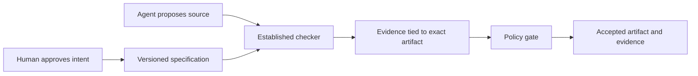

# Forge

**LLMs propose, checkers dispose. Humans approve intent (specs), not code.**

Forge is a public research prototype for **proof-gated software changes**.
Agents propose implementations. Established checkers decide whether the required
claims hold. Each accepted artifact carries reproducible evidence tied to its
exact bytes, specification, checking method, and assumptions.

The aim is to let agents change critical software components while people remain
responsible for the behavior those components must implement.

## The thesis

Generating code and establishing that it is acceptable are different tasks.
An agent can produce a plausible implementation and plausible tests for the same
mistake. Forge puts acceptance outside the proposing agent: a versioned spec
states the requirements, a policy names acceptable evidence, and an established
checker supplies the result.

Our working hypothesis is that this can reduce implementation review for small,
well-specified components. We have not yet measured the productivity benefit,
maintenance cost, or usefulness across ordinary repositories. Those measurements
are explicit roadmap stages.

The first target is a critical rule inside a larger application: money movement,
idempotent requests, booking constraints, refund limits, or permission decisions.
UI quality, model quality, and many integration properties still need tests and
measurements. Forge keeps those evidence types distinct.



The acceptance result is conditional on the recorded spec and trusted base.
A proof can establish the wrong requirement if the spec misses human intent.

## What works today

**Stages 0–5 are complete. Stage 6 is current; its booking spec awaits approval.**

The [booking proposal](proposals/booking.md) defines matching, cancellation, and
retry behavior. Its draft passed syntax and type checking only. The proposed
benchmark compares cold verification, shared source files, and native dependency
cache reuse. Booking proofs and benchmark results remain pending.

The ledger demo uses Dafny 4.11.0 and bundled Z3 4.12.1. Its approved source
refinement establishes these claims for sequential operations over mathematical
integers and finite maps, starting from a well-formed state:

| Claim | Required behavior |
| --- | --- |
| C1 | A transfer preserves total funds. |
| C2 | Resulting balances remain non-negative. |
| C3 | An identical accepted retry returns `Ok` without repeating its effect. |
| C4 | A fresh valid request terminates, debits amount plus one, credits the recipient by amount, and credits fee account `0` by one. |
| C5 | Every other request returns `Rejected` and leaves both state maps unchanged. |

Self-transfers are rejected. Reusing an accepted request ID with different
arguments is rejected. Fresh transfers need account `0`, cannot use it as sender
or recipient, and need funds for the amount plus the one-unit fee. Retries and
rejections pay no fee. See the [approved specification](spec/LedgerSpec.dfy),
[fee proposal](proposals/fees.md), and its [approval decision](proposals/fees-decision.md).

Four planted bugs pass the deliberately weak unit suite and fail the gate.
They cover money creation, an exact-balance boundary error, a repeated transfer,
and a forbidden assumption. The gate also rejects altered artifact identities,
insufficient evidence methods, and unsupported proof labels.

| Artifact or check | Established scope | Record |
| --- | --- | --- |
| Dafny ledger source | C1–C5, `source_proof`, under recorded assumptions | [Source evidence](evidence.json) |
| Handwritten TypeScript | 300 property runs and 4,131 state comparisons against the fee model; `tested_against_proved_model` | [Current comparison evidence](results/stage4/fee-typescript-evidence.json) |
| Local incremental gate | Valid Apply edit checked 2 member obligations and reused 10; broken dependencies were rejected | [Local controls](results/stage4-local.json) |
| Linux toolchain | Real installation, true-lemma acceptance, and false-lemma rejection | [Successful inventory run](https://github.com/mack-dot/forge/actions/runs/40397041174) |
| Spec quality | Successful-execution witness checked; reject-all vacuity flagged; 8/10 valid, audit-clean mutants killed, 2 survived | [Spec-quality report](docs/spec-quality.md) |
| Actual GitHub change loop | Implementation edit: 2 obligations checked, 10 reused. Approved fee spec change: 4 checked, 8 reused. Unapproved spec changes rejected; claims posted | [Fee PR](https://github.com/mack-dot/forge/pull/4) and [post-approval rejection](https://github.com/mack-dot/forge/pull/5) |

All five ledger claims currently share the Apply proof obligation. The
incremental counts describe member obligations, not five independent proofs.
The trusted baseline is fully checked first. [Change-loop notes](docs/stage4-change-loop.md)
describe native cache reuse, its MD5 checksum assumption, and exact replay.
The user approved the exact fee proposal, and its implementation is merged.
The trusted approval record binds the old and new spec/lock bytes and the frozen
proposal revision. A later C2 edit was rejected in a real PR. All three Stage 4 EXIT commands passed in the
[final recorded run](https://github.com/mack-dot/forge/actions/runs/40409284514).
The original Stage 3 results remain archived separately from the current fee
model comparisons.

[Generated claim explanations](docs/claims.md) link C1–C5 to their spec locations
and show real accept/reject examples. The Stage 5 report keeps invalid programs
and audit rejections separate from spec-proof kills. Its survivors include a
an algebraic rewrite control and an added print statement: the current contracts
do not constrain printed output. These finite diagnostics expose scope limits;
they do not prove that the spec captures every human requirement.

## Run the demo

First follow the [toolchain setup](toolchain/README.md) and
[TypeScript setup](ts/README.md). The current pins describe specific tested
environments; arbitrary local tool versions do not satisfy the gate.

```sh
python3 gate/gate.py --impl impl/Ledger.dfy --evidence evidence.json
python3 scripts/build_model.py
node --import tsx app/main.ts
```

The demo prints `Ok`, then `Rejected`. The supported Node loader invocation is
the approved demo command. The earlier `tsx` CLI socket failure remains in the
execution record.

Run the negative and reproducibility controls with the commands in
[ROADMAP.md](ROADMAP.md). A scenario can exit `0` because it observed the required
checker rejection. Reports keep the checker, gate, and scenario exit codes
separate.

## What an evidence bundle says

Each bundle names the claim, spec digest, artifact digest, method, tool version,
result, assumptions, trusted components, producer, and reproduction command.
The gate validates those bindings and the policy. Imported evidence must match
a fresh checker run; valid JSON alone establishes no proof.

`source_proof`, `bounded_model_checked`, `tested_against_proved_model`, and
`unit_tested` retain their meanings. The gate never promotes a test result to a
proof. Stronger-sounding evidence about a different property cannot satisfy a
required claim.

Current evidence keeps **`end_to_end=false`**. The Dafny source proof does not
cover the compiler, generated JavaScript, handwritten TypeScript, persistence,
concurrency, or a deployed application. Binary checking and deployment identity
are later roadmap work. A signature will authenticate a bundle; it will not
prove the program's behavior.

## Follow and contribute

| Document | Purpose |
| --- | --- |
| [ROADMAP.md](ROADMAP.md) | Stages 0–10, required EXIT checks, and actual results. |
| [docs/claims.md](docs/claims.md) | Generated claim explanations and observed behavior examples. |
| [docs/spec-quality.md](docs/spec-quality.md) | Checked success witness, mutation results, and reproduction commands. |
| [Stage 5 logs](results/stage5/logs/index.json) | Raw checker logs, including preserved driver failures. |
| [unsure.md](unsure.md) | Append-only findings, uncertainty, corrections, and resolutions. |
| [docs/stage4-change-loop.md](docs/stage4-change-loop.md) | Current change-loop implementation and limits. |
| [proposals/fees.md](proposals/fees.md) | Frozen fee intent, exact diff, content digests, and examples; see its decision record. |
| [gate/README.md](gate/README.md) | Gate commands and rejection controls. |
| [ts/README.md](ts/README.md) | Model compilation, property tests, and evidence boundaries. |
| [VISION.md](VISION.md) | Long-term directions and irreducible limits. |
| [AGENTS.md](AGENTS.md) | Instructions for agents working in this repository. |

Work only on the CURRENT stage. Propose spec changes with an exact diff and
plain-English reason, then wait for human intent approval. Do not weaken a spec,
policy, or gate to pass a check. Preserve the uncertainty log and record real
commands and exit codes. Planned work is not a passing result.

## License

A license has not yet been selected. Public visibility alone does not grant an
open-source license. License selection remains an open release item.
