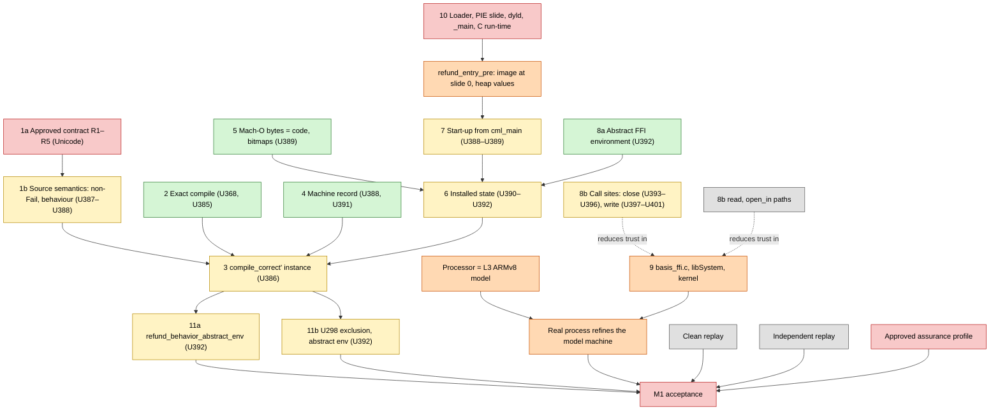

# M1 proof dependencies (U401 audit)

Date: 2026-11-16. Audit only. CURRENT none. M1 open. Stage 12
unauthorized. No profile approved. `end_to_end=false`. Nothing committed.

Sources: `FORGE_MISSION.md`, `FORGE_MISSION_STATUS.md`, `ROADMAP.md`,
the `REPORT.md` of each `m1-*` packet (U350–U400), and the U401 run
`results/refund-write-word-local-20261116/attempt-0001`. Reports U350–U396
were read by two read-only extraction agents; I did not re-read every
line. Records before U345 (source contract, Unicode) were NOT re-audited.

Every "PROVED" below means: HOL4 kernel, local machine, same agent,
cached parent theories. No CakeML-dependent theorem has a clean replay.
No theorem has an independent replay.

Status words: PROVED, CONDITIONAL, ASSUMED, OPEN, NOT RUN.

## 1. Components

| # | Component | Status | Main evidence | Premises or gap |
| --- | --- | --- | --- | --- |
| 1a | Approved refund contract R1–R5 (integer/Unicode) to the HOL model `eligible` / `refund_fields` | OPEN (last record) | `forge_refundScript.sml` header: "Transfer from the approved Unicode input domain … remain open"; status file: "manually constructed AST still needs a checked representation relation" | NOT re-audited in U401. No later packet claims this link |
| 1b | Source semantics does not fail; behaviour for all present input | CONDITIONAL | `refund_source_nonfail_stdin`, `refund_accept_semantics`, `refund_reject_semantics` (U387, U388) | `stdin_content fs = SOME text`, `wfcl`, `wfFS`, `STD_streams`; oracle `basis_ffi`. Absent input, general `ffi`: OPEN |
| 2 | Exact compilation | PROVED | `refund_alloc_compiled` (U368); `refund_lab_compile`, `refund_lab_good_code` (U385) | For `refund_alloc_oracle`. The published constant `oracle` is not related to it (U391 finding) |
| 3 | Published compiler correctness | CONDITIONAL | `compile_correct'` replayed (U386); `refund_compile_correct_no_handler` | Replay ran in the Forge heap, not a clean rebuild. Discharge of `backend_config_ok`, `mc_init_ok`, `opt_eval_config_wf` for this configuration: NOT FOUND in the reports read |
| 4 | ARMv8 machine configuration | PROVED (record) | `refund_mc_is_arm8`, `refund_mc_concrete_fields` (U388, U391) | The record is a model object. Its relation to the processor is ASSUMED |
| 5 | Mach-O bytes equal compiled code and bitmaps | PROVED (file) | `refund_file_code`, `refund_file_bitmaps` (U389); SHA256 `b8ed5ec2…7bb8` | ML file reader trusted; offsets from a Python tool; no Mach-O parser in HOL |
| 6 | Memory domains, installed state | CONDITIONAL | 23 of 30 clauses (U390); 5 more (U391); last 2 for the abstract record only (U392) | Entry pre-state, `refund_heap_clear`, `prog_addresses = refund_mem_dm h e`, slide 0 |
| 7 | Start-up from `cml_main` | CONDITIONAL | `cml_main_run` (27 steps), `refund_loader_startup` (U388, U389) | `refund_entry_pre` ASSUMED. Process entry, `_main`, C run-time: no model |
| 8a | FFI in the model (abstract environment) | PROVED for `refund_abs_env` | `refund_abs_ffi_contract`, `refund_abs_env_rest2` (U392) | `refund_abs_ffi` is related to no executable byte |
| 8b | FFI call sites and real C paths | CONDITIONAL, partial | `close`: U393–U396. `write`: U397–U401. | `read`, `open_in`: NOT RUN. See section 3 |
| 9 | External C implementation, `libSystem`, kernel | ASSUMED | `close_call_rel`, `write_call_rel` are assumed relations | No model. Oracle conformance: not stated in HOL |
| 10 | Loader, PIE slide, dynamic binding | ASSUMED / OPEN | Image lemmas hold for every slide (U389) | All composed theorems are at slide 0. `MH_PIE` is set. U389: slide 0 "probably false for a real process"; not measured |
| 11a | Observable behaviour | CONDITIONAL | `refund_behavior_abstract_env` (U392): `machine_sem ⊆ extend_with_resource_limit {Terminate Success io}` and the `extract_fs` equation | Premises of rows 6, 7 and 1b; abstract environment; slide 0 |
| 11b | U298 installer exclusion | CONDITIONAL | `refund_u298_exclusion_abstract_env` (U392); general form `refund_u298_exclusion_real` (U386) | Same premises. Without premises: NOT ESTABLISHED |
| — | Clean replay | NOT RUN | Two ARM8 theorems only (U360) | CakeML-dependent chain: never |
| — | Independent replay | NOT RUN | — | Needs authorization and a budget |
| — | Native execution | NOT RUN | — | The binary was never executed |

## 2. Graph

Green: proved. Yellow: conditional. Orange: assumed. Red: open. Grey:
not run. A dotted edge is optional for M1 under Profile A (section 4).

## 3. The `write` and `close` branch (rows 8b)

| Item | Status | Evidence |
| --- | --- | --- |
| `close` path, 15 + 6 steps | CONDITIONAL | `cake_fficlose_path` (U394) under `fficlose_call_pre`, `close_call_rel` |
| `close` arguments at reachable model states | CONDITIONAL | `close_call_site_arguments` (U395); sign needs a new premise (U396) |
| A reachable `close` call | OPEN | Sources indicate none; unreachability proof NOT RUN (U396) |
| `write` path, both outcomes | CONDITIONAL | `cake_ffiwrite_path_returns` (U398) under `ffiwrite_call_pre`, `write_call_rel`, `¬SCTLR_EL1.A` |
| `write` event implies reachable call state | PROVED (model) | `evaluate_trace_events` (U399) |
| Output never empty | PROVED | `refund_render_fields_not_empty` (U400) |
| Terminating run reaches a call with `x1 = 8` and the numeric bound | CONDITIONAL | `refund_terminating_run_reaches_valid_write_call` (U400). Premise: `Terminate Success` |
| Numeric bound equals the word-level conjunct | PROVED | `write_bound_numeric_iff_word`, `write_bound_word_value_no_overflow` (U401, `word-0003`) |
| `ffiwrite_call_pre` reduced to 12 residual conjuncts | PROVED | `write_call_pre_from_residual`, `write_call_pre_gives_residual` (U401) |
| The 12 residual conjuncts | OPEN | `arm8_user`; image at slide 0; alignment of frame, `c`, `a`; `¬word_msb x3`; six separation clauses |
| Every `write` event successful (source level) | OPEN | Not derivable from the exported specification: `replay_ignores_failed_write_with_valid_clen` (U401) |
| `read`, `open_in` | NOT RUN | — |

U401 note. `word-0003` exited 0 with 19 theorems. I read its stored
statements. No separate exact-statement import or scope-control script
ran for it. It has one run only.

## 4. Two readings of the FFI boundary

Profile A (U360, not approved) keeps "native FFI code `basis_ffi.c`
meets `ffi_interfer_ok`" as ASSUMED for all FFI functions. Under that
reading rows 8b are supporting evidence, not M1 obligations.

One caution from the evidence. U393 found by disassembly analysis (not a
theorem) that the real `fficlose` cannot satisfy the clause for all call
states, because of its `assert` paths. So the literal assumption
`ffi_interfer_ok` is probably false for the real C code. The sound form
is the abstract-environment theorem plus one simulation assumption
(graph node "Real process refines the model machine"). Rows 8b are the
start of a proof of that assumption for the FFI part.

## 5. Duplicated, unnecessary or too-strong assumptions

- `refund_static` (U395–U401) repeats facts of `refund_mc_concrete_fields`
  (U391). `refund_abs_record_static` (U395) links them for the abstract
  record. In the U399–U401 refund theorems it is still a separate premise.
- `refund_installed_no_handler` is a premise of the U399–U401 theorems.
  U392 proves it for the abstract record from the entry premises. The
  U399–U401 theorems were not re-based on the U392 form. NOT RUN.
- `Terminate Success` is needed only by the `write` branch. The M1
  behaviour theorem does not need it; it allows a resource-limit prefix.
- `close` obligations are probably vacuous for refund runs (U396). This
  is source inspection. They stay in the contract until unreachability
  is proved.
- `ffi_interfer_ok` for all call states is stronger than needed and
  probably false (section 4). The needed form is per reachable call.
- Slide 0 is stronger than needed and probably false for a PIE process.

## Correction (U402, 2026-11-16)

Two statements of this U401 file are corrected by
[the U402 packet](../m1-profile-decision-20261116/M1_PROFILE_DECISION.md):

1. `refund_behavior_abstract_env` does NOT carry the output (`extract_fs`)
   equation. Its `io_events` is unconstrained. The output equation is
   only in `refund_behavior_valid_request_no_handler` (U387), not
   composed with the entry state. This is a further blocking obligation.
2. `backend_config_ok`, `mc_init_ok` and `opt_eval_config_wf` are
   discharged inside the U386 proof scripts from published theorems.
   The "NOT FOUND" gap is resolved by location; a clean replay is still
   needed.

The original text above is left unchanged.
